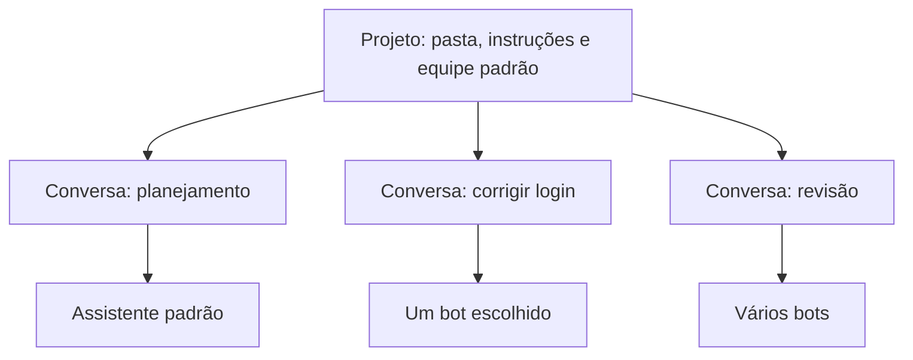

# Conversas, projetos e bots na V9

Data: 16/10/2026. Estado: estratégia proposta a partir dos requisitos do usuário e da inspeção do produto. Este documento define o próximo fluxo; não certifica implementação.

## Necessidade e resultado

O usuário gosta da identidade dos bots, das conversas diretas e da colaboração do OpenMausBot. Também quer abrir um projeto e conversar sem cadastrar um bot ou criar um grupo, manter várias conversas no projeto e acompanhar alterações de código como diffs dentro do chat. O aplicativo desktop deve servir tanto para uma pergunta simples quanto para trabalho com uma equipe. Modo da interface: operar, com conversa e resultado como foco.

O fluxo deve permitir começar imediatamente e acrescentar participantes conforme a tarefa pede. O resultado esperado é abrir um projeto, iniciar uma conversa com o assistente padrão ou com a equipe escolhida, receber trabalho real e conferir os trechos alterados sem sair do chat.

O usuário acrescentou a promoção opcional de um bot a **Chief**, capaz de administrar a plataforma por ferramentas internas e atuar em grupos a partir de uma conversa privada. Chief é o termo correto para essa capacidade.

## Estrutura proposta

**Projeto guarda contexto e conversas. Participantes definem quem responde. Bot guarda identidade e capacidades.**



- Um projeto pode ter zero, um ou vários bots configurados como equipe padrão. Criar um projeto exige somente nome; a pasta é opcional para conversar e necessária para trabalhar nos arquivos escolhidos.
- Sem bots escolhidos, uma nova conversa usa **Assistente**, disponível pelo aplicativo, com modelo selecionável. O usuário não precisa cadastrá-lo. É um perfil de execução do motor, sem outra IA intermediária.
- Com um bot escolhido, só ele responde. Com vários, a conversa funciona como grupo. Os participantes aparecem no cabeçalho antes do envio.
- Ao escolher bots, o Assistente padrão deixa de ser o destinatário automático; não continua respondendo como um participante extra escondido.
- A equipe padrão facilita iniciar novas conversas do projeto. Alterar essa equipe não muda silenciosamente os participantes das conversas existentes ou em execução.
- Conversas mantêm sessões próprias por participante. Compartilhar um projeto não significa compartilhar automaticamente todo o transcript entre sessões.
- Clicar diretamente em um bot abre sua conversa, como no Mausbot. O perfil é acessado por uma ação separada. Esse caminho também funciona fora de projetos.
- Conversas coletivas avulsas continuam possíveis. O usuário não precisa criar um grupo adicional dentro do projeto para habilitar colaboração.

Assim, o que o usuário chama de “grupo do projeto” pode ser representado pela equipe daquele projeto, com várias conversas independentes abaixo dele. Evitar uma sequência obrigatória “criar projeto → criar grupo → criar sessão” para começar a falar.

## Fluxos e navegação

| Intenção | Ação | Resultado visível |
| --- | --- | --- |
| Fazer uma pergunta rápida | Nova conversa | Chat com Assistente, sem cadastro obrigatório |
| Falar com um bot | Clicar no bot | Conversa direta, com identidade e modelo do bot |
| Trabalhar em um projeto | Abrir projeto → Nova conversa | Chat no contexto do projeto, com destinatários visíveis |
| Usar somente um especialista | Escolher um bot como participante | Somente esse bot executa |
| Trabalhar em equipe | Adicionar bots à conversa ou à equipe padrão do projeto | Conversa coletiva, com autoria e delegações rastreáveis |
| Abrir outro assunto no mesmo projeto | Nova conversa dentro do projeto | Outra sessão, com o contexto do projeto e histórico independente |
| Conferir uma alteração | Expandir o cartão de arquivo no chat | Diff do trecho efetivamente alterado e identificação do autor |
| Montar ou ajustar uma equipe por conversa | Pedir ao Chief no privado | Bots, modelos e participantes configurados no escopo concedido, com recibos das mudanças |
| Comunicar algo à equipe pelo privado | Pedir ao Chief ou a um bot autorizado que publique no grupo | Mensagem no destino assinada pelo bot e confirmação vinculada na origem |

A lateral mantém a linguagem visual atual e organiza três entradas: **Nova conversa**, **Projetos** com suas conversas e **Bots** com suas conversas diretas. Um atalho para conversa coletiva avulsa fica no menu de criação; não compete com o fluxo principal. O chat ocupa o centro. Terminal, navegador e detalhes aparecem em painéis sob demanda.

No cabeçalho, mostrar projeto quando houver, título e participantes. Modelo e recursos continuam acessíveis por controles compactos. “Adicionar bots” muda os destinatários dos próximos envios; durante um turno, informar que a alteração entra no próximo envio. Preservar autoria e histórico anteriores.

Ao adicionar um bot a uma conversa existente, o serviço deve oferecer o pedido atual e o contexto necessário. Não copiar automaticamente histórico completo, aprovações ou permissões de outro participante. Acesso à pasta e uso do computador continuam explícitos, inclusive para o Assistente padrão.

Em conversa coletiva, permanece a regra vigente: mensagem humana sem menção executa todos os participantes ativos; com menções, somente os mencionados. Respostas comuns de bots não iniciam outra rodada. Se houver mudança futura nessa regra, ela precisa ser explícita no produto.

## Chief: administrar e coordenar por conversa

Chief é uma capacidade opcional concedida pelo usuário a um bot existente. O usuário pode promover ou remover essa capacidade e escolher abrangência global ou projetos/grupos específicos. Não exige criar CEO, tech lead ou uma hierarquia fixa; o Assistente padrão e bots comuns continuam utilizáveis independentemente de existir um Chief.

O objetivo é paridade entre as operações da interface e as ferramentas internas autorizadas: o Chief consegue cadastrar/editar bots, criar e organizar projetos/grupos, adicionar ou remover participantes, configurar instruções e modelos disponíveis e coordenar trabalho. Essas operações usam os mesmos serviços e validações que a interface, sem depender de cliques ou de acesso direto ao SQLite.

Fluxo de referência: no privado, o usuário pede “Crie uma revisora, configure o modelo escolhido, coloque-a no projeto Site e peça para revisar o login”. Com os poderes necessários já concedidos, o Chief cria e configura uma vez, adiciona a participante, delega o pedido e retorna o resultado correlacionado. Cada etapa informa aceitação, execução ou falha reais. A mesma cadeia continua depois da configuração sem pedir novamente uma autorização que o usuário já concedeu.

| Operação | Comportamento |
| --- | --- |
| Descobrir projetos, grupos, bots e modelos | Listar somente o escopo concedido e opções reais do motor |
| Criar e configurar bots | Registrar identidade, instruções, motor/modelo e capacidades permitidas |
| Criar e administrar projetos/grupos | Ajustar nome, contexto e participantes com estado persistido |
| Mudar modelo de outro bot | Aplicar ao padrão de próximas execuções; preservar o modelo registrado de turnos e sessões existentes |
| Publicar em grupo a partir do privado | Gravar uma mensagem assinada pelo Chief/bot e devolver recibo na conversa de origem |
| Pedir trabalho a participantes de outro contexto | Usar delegação explícita, sessões próprias, fila e retorno rastreável |
| Acompanhar pedidos | Consultar estados e resultados reais das cadeias sob sua coordenação |

Publicar um aviso no grupo não inicia execução de todos os membros. Pedir trabalho usa a ferramenta de delegação e identifica destinatários. Essa distinção permite “avise o grupo” e “peça à Revisora para analisar” sem criar rodadas automáticas ou ciclos.

A conversa de origem não define todo o alcance do bot: um Chief autorizado pode atuar em um grupo mesmo recebendo a instrução no privado. O serviço resolve autoria, destino e permissões de cada operação. Publicações aparecem como ações do bot, não como mensagens humanas forjadas. O registro liga conversa de origem, grupo/projeto de destino, operação, estado e resultado, com chave de deduplicação.

Poder administrativo e acesso ao contexto são concessões distintas. Promover a Chief não copia todos os transcripts para sua sessão nem transfere suas permissões aos bots criados ou coordenados. O usuário pode conceder administração ampla; a interface deve tornar essa abrangência visível. Revogar a capacidade impede novas operações. Alterações de modelo/participantes são aplicadas nos próximos envios e não redirecionam um turno já iniciado.

Na instalação do OpenMausBot inspecionada, `chief-of-staff.js` e `drivers/agents-proxy.js` expõem criação/configuração de bots, modelos, criação/gestão de salas e publicação em salas. Os contratos distinguem escopo de equipes e nível de acesso; `post_to_room` publica sem iniciar turnos, enquanto `coordinate_bots` delega trabalho. Essa inspeção confirma os contratos da referência, não uma execução dessas funções no Politron.

## Alterações de arquivo dentro do chat

Cada escrita real gera um cartão associado ao turno, ao autor e ao arquivo. Mostrar caminho, estado da ação e contagem correta de linhas adicionadas/removidas. Ao expandir, apresentar somente os trechos alterados com contexto próximo, linhas e destaque de inclusão/remoção. Vários arquivos de um mesmo turno podem aparecer reunidos em “Arquivos alterados”.

Exemplo de apresentação, ilustrativo:

```diff
src/Login.tsx · Implementador · Alteração aplicada
- const label = 'Entrar';
+ const label = loading ? 'Entrando…' : 'Entrar';
```

O cartão vem da ferramenta de edição, comparando conteúdo anterior e posterior; o texto do modelo não é prova de uma mudança. Distinguir **aplicada**, **falhou**, **resultado indeterminado** e uma eventual **proposta**. Uma escrita que falhou não ganha estado de aplicada. Se nada mudou, indicar ausência de alteração.

Persistir o registro e o diff para recuperar a evidência após reinício, mesmo se o arquivo for editado novamente depois. Repetir um evento não duplica o cartão. Arquivos grandes, binários e truncamentos precisam de indicação clara; diffs extensos abrem sob demanda. Não oferecer desfazer até existir restauração com detecção de mudanças posteriores.

O `DiffViewer.tsx` existente, baseado em `@pierre/diffs`, é candidato ao reaproveitamento. O `DiffCard.tsx` antigo depende do store legado e calcula apenas a diferença no total de linhas; deve ser adaptado para os eventos V9 e contagens reais, sem acoplar o novo chat ao estado antigo.

## Consequências para o domínio e a implementação

O domínio atual reúne pasta, participantes e conversa em `Conversation`. O armazenamento exige pelo menos um agente cadastrado e um nome. Para esta estratégia, introduzir `Project` e a associação opcional `Conversation.projectId`, manter participantes por conversa e representar o Assistente padrão como perfil do aplicativo. A interface pode usar título inicial automático; não exigir formulário para cada chat.

A sessão continua ligada a conversa, participante, motor e revisão do contexto. O projeto fornece pasta e instruções compartilhadas selecionadas; conversas distintas não reutilizam a mesma sessão global. Trocar de pasta não muda o contexto de uma execução já iniciada.

Acrescentar um registro de alteração de arquivo associado a mensagem, execução, chamada de ferramenta e autor, com comparação anterior/posterior, estado e identificador estável para deduplicação. A ferramenta `workspace_write` atual valida o destino e grava o arquivo, mas devolve somente uma string; ela ainda não produz esse registro.

Delegações continuam usando o serviço existente, suas sessões e permissões próprias e seus vínculos persistidos. Conversas internas de tarefas precisam aparecer como atividades relacionadas, evitando poluir a lista principal de conversas criadas pelo usuário; manter um caminho para abrir o histórico do destinatário.

Introduzir concessões de administração da plataforma associadas ao bot e ao escopo, separadas de permissões de escrita/Computer Use. Publicar ferramentas tipadas sobre os serviços existentes de cadastro, conversas e modelos; acrescentar criação/gestão de projetos quando esse domínio existir. Registrar operações administrativas com origem, destino e recibo durável. O broker resolve o bot chamador pelo contexto de execução, sem aceitar identidade ou poderes declarados pelo modelo.

## Ordem de entrega e provas

1. **Conversa imediata:** Assistente disponível sem cadastro, clicar em bot abre chat e edição fica separada. Provar primeira execução e recuperação do histórico.
2. **Projetos com conversas:** criar projeto, associar pasta/instruções opcionais, manter várias conversas e equipe padrão. Provar projeto sem bot, com um bot e com vários, isolamento de sessões e persistência. Migrar dados V9 existentes com backup e preservar banco legado e índice Git.
3. **Diff no chat:** registrar escrita real e apresentar cartões persistidos. Provar criação e edição de arquivo, falha de escrita, ausência de mudança, evento repetido, dois autores e recuperação após reinício.
4. **Integração da colaboração:** manter despacho, menções, fila por pasta e cancelamento; organizar tarefas delegadas como atividades relacionadas. Provar que mudanças de participantes e navegação não redirecionam execuções em andamento.
5. **Chief e operações internas:** promoção/revogação pelo usuário, ferramentas de administração e publicação entre conversas, respeitando o escopo concedido. Provar no privado a criação de um bot, seleção de modelo real, associação a projeto/grupo, mensagem no grupo e delegação com retorno; testar duplicação, falha parcial, revogação e persistência. Não certificar a capacidade somente porque uma ferramenta foi exposta ao modelo.

Preservar Electron, adaptadores existentes, tokens, fontes e 14 temas. A mudança é de fluxo e hierarquia da informação. A inspeção atual comprova as divergências do código e os componentes reutilizáveis; os fluxos acima ainda precisam ser implementados e validados.

## Limites desta proposta

Os requisitos confirmados são conversa em projeto sem cadastro obrigatório, opção de equipe com um ou mais bots, conversas independentes no projeto, conversa direta com bots, diff visível nas edições e promoção opcional a Chief com operações internas e acesso concedido a grupos a partir do privado. A organização “Projeto + equipe padrão + participantes por conversa + Chief opcional” é a solução proposta para esses requisitos. Nome comercial, avatares animados e outras capacidades do ChatGPT não são pré-requisitos dessa entrega nem foram aprovados por esta proposta.
