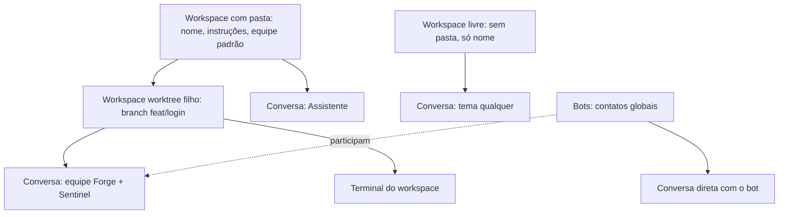

# Estratégia Politron: Paseo + OpenMausBot

Data: 16/10/2026. Este documento é a fonte de verdade do projeto a partir de agora. Substitui `PLANO_V9.md` e `ESTRATEGIA_CHAT_V9.md` como guia de execução; as decisões de produto desses dois continuam valendo onde não forem contrariadas aqui.

## 1. Objetivo

Politron é um aplicativo desktop (Electron, Windows) para programar com agentes, no estilo ChatGPT/Codex Desktop, que junta:

- **De Paseo** (https://github.com/getpaseo/paseo, Apache-2.0): organização centrada em código. Projeto, workspaces (checkout local ou worktree com branch própria), terminal por workspace, diff e mudanças do repositório à vista, badge de "precisa de atenção", seletor `motor/modelo`, perfis de agente.
- **De OpenMausBot** (https://github.com/milind-soni/OpenMausBot, Apache-2.0 exceto `enterprise/`): organização centrada em conversa. Bots como contatos com identidade própria, clique abre o chat, grupos com vários bots, delegação explícita entre bots, Chief que administra a equipe por ferramentas internas, aprovações inline no chat.

Resultado esperado para o usuário: abrir o app, escolher um projeto, abrir um workspace, conversar com o Assistente padrão, com um bot ou com uma equipe, ver os arquivos alterados como diff dentro do chat, usar terminal e navegador do mesmo workspace, e acompanhar várias frentes em paralelo sem que uma pise na outra.

## 2. Modelo de domínio unificado

**Atualizado em 16/10/2026:** Projeto deixou de existir como entidade separada. O usuário pediu, em conversa, que Workspace vire o único nível organizador, igual à lista plana do Paseo, podendo ser criado com ou sem pasta pelo mesmo fluxo. Workspace agora carrega nome, instruções e equipe padrão próprios (o que antes era de Projeto); um worktree é um Workspace filho (`parentWorkspaceId`) do workspace que o originou. Conversa sempre pertence a um Workspace; quando esse workspace não tem nome (criado automaticamente, sem o usuário escolher), a conversa aparece solta no topo da barra lateral em vez de na árvore de Workspaces. Isso reabre o que a Fase 2 já havia implementado como "concluída" com Projeto + Workspace separados; a migração de esquema (4 para 5) funde os dois.

| Entidade | Origem | Regras |
| --- | --- | --- |
| **Bot** (`Agent`) | MausBot | Identidade (nome, avatar, cor, descrição), instruções, motor e modelo, permissões (`canWrite`, `computerUse`, modo de aprovação). Global, não pertence a workspace. Clique abre conversa direta; editar perfil é ação separada. |
| **Assistente** | GPT Desktop | Perfil embutido (`ASSISTANT_ID`), sem cadastro. Responde quando a conversa não tem participantes. |
| **Workspace** | Paseo (unificado) | Nome, `kind: 'local' \| 'worktree' \| 'free'`, `path` (sempre real; gerenciado pelo app quando `free`), `branch`, `baseBranch`, `parentWorkspaceId` (worktree aponta pro workspace de origem), `instructions`, `defaultAgentIds`, `archived`. Criado com ou sem pasta pelo mesmo fluxo; sem pasta e sem nome = workspace privado automático, que fica fora da árvore até o usuário dar nome. |
| **Conversa** | Ambos | Sempre pertence a um workspace (nunca solta no banco). Workspace sem nome = conversa some na lista plana do topo; workspace nomeado = conversa aparece na árvore de Workspaces. Participantes próprios (zero = Assistente, um = só ele, vários = grupo). Título automático. |
| **Run / Sessão** | V9 atual | Sessão por conversa + participante + motor + revisão de contexto. Nunca compartilhada entre conversas. |
| **Delegação** | MausBot + V9 | `ask_agent` com estado durável, deduplicação, cancelamento, sem ciclos (já implementado). |
| **Alteração de arquivo** (`FileChange`) | Paseo | Registro persistido de cada escrita real com diff anterior/posterior, autor, run, estado. |
| **Concessão Chief** | MausBot | Capacidade administrativa opcional dada a um bot, com escopo. Última fase. |

Regras de conversa atuais: sem menção, responde um agente, escolhido pelo líder configurado ou pelo modo automático via OpenRouter; menções direcionam somente aos citados; envio a todos é explícito. Rodadas colaborativas são opt-in; respostas de bots não iniciam novas rodadas. Mudar participantes vale para o próximo envio, nunca redireciona turno em andamento.

**Conflito de nomes:** hoje `WorkspaceService`, `WorkspaceAPI`, `workspaceAPI` e `features/workspace/Workspace.tsx` designam o app inteiro. Na Fase 0 renomear para `AppService`, `AppAPI`, `appAPI` e `features/app/AppShell.tsx`, liberando "Workspace" para o conceito do Paseo. **(Feito na Fase 0.)**

## 3. Layout

Manter tokens, fontes e os 14 temas atuais. Mudança é de hierarquia, não de identidade visual.

- **Barra lateral esquerda**, de cima para baixo:
  1. Botão **Nova conversa** (Assistente, sem projeto).
  2. **Projetos**: árvore Projeto > Workspaces (ícone de branch, nome da branch, badge de atenção, fixar, arquivar) > Conversas. Ação "Novo workspace" no menu do projeto (local já existe; criar worktree pede nome da branch e base).
  3. **Bots**: lista de contatos com avatar, status (ocioso, trabalhando, aguardando aprovação) e não lidas. Clique abre a conversa direta mais recente; menu de contexto: Nova conversa, Editar perfil, Promover a Chief (Fase 8).
- **Centro**: chat. Cabeçalho mostra `Projeto / workspace (branch) · título · chips dos participantes · motor/modelo`. Atividades de delegação aparecem como cartões ligados à conversa do destinatário.
- **Painel direito sob demanda** (abas): Arquivos alterados (diff), Terminal, Navegador, Detalhes da conversa.
- **Configurações**: tela própria (motores e binários, modelos padrão, tema, pasta de worktrees). Hoje `/settings` cai no mesmo componente principal.
- **Atenção** (Paseo): quando um run termina ou pede aprovação fora da conversa aberta, badge na conversa, no workspace e no bot, e notificação do Windows.

## 4. Estado atual (verificado em 16/10/2026)

- `master` em `9336c16`. A branch `v9/assistente-projetos` e o worktree `politron-v9-slice` foram unificados em `master` e removidos. Backups do estado anterior do working tree: refs `refs/backup/master-wt-2026-10-16` e `refs/backup/master-index-2026-10-16`.
- Pilha ativa (V9): `apps/desktop/src/main/v9/*`, `src/shared/v9.ts`, `src/renderer/src/features/workspace/Workspace.tsx` (173 linhas densas). Motor único: Codex via `codex app-server` (JSON-RPC stdio), ferramentas próprias por `dynamicTools`, sandbox `read-only`, shell desligado. SQLite `politron-v9.sqlite` esquema 3 com backup na migração.
- Feito: Assistente padrão, projetos com várias conversas e equipe padrão, broadcast/menções, `ask_agent` entre conversas com estado durável, navegador controlado pelo agente.
- Falta: clique no bot abrir chat, diff no chat, workspaces/worktrees, terminal ligado ao workspace (hoje recebe qualquer `cwd` do renderer e depende de `activeTeamAtom` legado), aprovações inline, motor Claude, Chief, tela de configurações.
- Testes: `cd apps/desktop/src/renderer && npx vitest run` dá 62 passando, 1 pulado (integração Codex real, `POLITRON_RUN_CODEX_INTEGRATION=1`), 3 falhando, todos legados (CEO/Tech Lead).
- Bagunça: pilha legada inteira (OpenCode SDK, CEO, pipeline, team-store, 60 handlers IPC em `ipc/handlers.ts`) continua sendo inicializada em `src/main/index.ts:174-189` sem ser usada pela UI; `package.json` aninhado em `src/renderer` com as dependências reais do front; `apps/desktop/package.json` sem `test`/`typecheck`; typecheck amplo com erros; mais de 12 MB de artefatos legados (`.opencode/`, `.vendor/agency-agents`, `.sisyphus/`, `specs/`, mockups).

## 5. Plano de execução

Cada fase termina com commit em `master`, testes verdes, typecheck limpo e evidência registrada na seção 7. Não começar uma fase com a anterior vermelha.

### Fase 0: Limpeza e base única

Objetivo: só existe uma pilha, ela compila sem erros e os testes refletem o produto.

1. Criar tag `legado-pre-limpeza` no commit atual antes de apagar qualquer coisa. O histórico do Git é o arquivo; não copiar código legado para pastas `legacy/`.
2. Remover do processo principal: registro de `registerHandlers()` legado, `appStateDb.init`, `pipelineExecutor.hydrate`, `teamStore.hydrate`, ajuste de PATH do OpenCode e o bloco `POLITRON_ENABLE_LEGACY`. Preservar só o IPC do terminal e o que a V9 usa (confirmar com grep antes).
3. Apagar a pilha legada que nada da V9 importa: `services/opencode-sdk.ts`, `ceo-*`, `pipeline-executor`, `entry-point-router`, `agent-capability`, `agent-catalog`, `internal-agents`, `internal-tools/`, `team-store`, `session-store`, `task-tool-bridge`, `provider-router`, `agency-agent-sync`, `config/features.ts`, `types/ceo`, `types/team`; no renderer `features/chat/*` (exceto `DiffViewer.tsx`, `DiffCard.tsx`, `FileChangesCard.tsx`, mover para `features/diff/`), `features/group-chat/*`, `pages/Index.tsx`, `hooks/useWorkspace.tsx`, `components/ide/*` exceto `TitleBar`, `ThemeSelector`, `TerminalPanel`, `components/setup`, `SettingsScreen.tsx` antigo. Apagar os testes legados correspondentes. Antes de cada remoção, `grep` de importações.
4. Apagar artefatos: `.opencode/`, `.vendor/agency-agents`, `.sisyphus/`, `specs/`, `scripts/convert-agency-opencode.mjs`, `package-lock.json` vazio da raiz, `vibecoding_ide_mockup.html`, `apps/desktop/tmp-electron-global.cjs`, `test-electron.ps1`, `src/renderer/dist`, mocks e componentes `ui/*` sem importação.
5. Mover documentos históricos para `docs/arquivo/`: `PLANO_V9.md`, `ESTRATEGIA_CHAT_V9.md`, `OPENMAUSBOT_REFERENCIA.md`, `PROMPT_LUNA_V9.md`, `CHAT_DESIGN_INPUT_Version2.md`, `REAPROVEITAMENTO_ARQUITETURA_Version2.md`, `PAPERCLIP_ANALYSIS.md`, `vibecoding-ide-prompt.md`. Raiz fica com `AGENT.md`, `PRODUCT.md`, `ESTRATEGIA_POLITRON.md`. Atualizar `AGENT.md` para apontar para este documento.
6. Unificar pacotes: um único `apps/desktop/package.json` com todas as dependências do main e do renderer; remover `src/renderer/package.json` e seu `node_modules`; mover `vitest.config.ts` para `apps/desktop`. Scripts: `dev`, `build`, `test`, `test:codex` (com a variável de integração), `typecheck`, `lint`. Remover dependências que deixaram de ser importadas (`@opencode-ai/sdk`, `@assistant-ui/*`, `xterm` v5 duplicado de `@xterm/xterm`, `@anthropic-ai/sdk` se só o MiniMax usava).
7. Renomear o conflito de nomes da seção 2 (`WorkspaceService` para `AppService` etc.).
8. Quebrar `Workspace.tsx` em módulos legíveis: `features/app/AppShell.tsx`, `features/sidebar/`, `features/chat/` (lista, mensagem, cabeçalho), `features/composer/`, `features/panels/` (navegador, terminal), `features/editors/` (bot, projeto, conversa). Sem mudar comportamento.
9. `typecheck` cobrindo main, preload, shared e renderer, com `strict: true` ao menos para `main/v9`, `shared` e o renderer novo.

Aceite: `npm ci && npm run typecheck && npm test && npm run build` em `apps/desktop` sem erro; app abre com `npm run dev`; conversa com Assistente via Codex real responde; integração `npm run test:codex` passa.

### Fase 1: Navegação MausBot + Paseo

Estado: concluída em 16/10/2026. Composer centralizado e sem cartão externo; fluxos simples de conversa/projeto; Assistente padrão quando não há agentes e nome obrigatório para grupo; avatar e formulário de agente simplificado; agentes como contatos com conversas diretas e ações no menu; equipe padrão e pasta opcional em projeto; chips para alterar participantes nos próximos envios; seletor de modelo sincronizado ao composer; tela própria de configurações; estados ocioso/trabalhando/aguardando e contadores de não lidas persistidos localmente. “Pits” é o mascote provisório: SVG animado com CSS leve e movimento reduzido respeitado.

1. Barra lateral conforme seção 3 (Nova conversa, Projetos em árvore, agentes como contatos).
2. Clique no agente abre conversa direta (a mais recente ou cria uma); editar perfil por menu. Conversas diretas também listadas sob o agente.
3. Cabeçalho com projeto, título, chips de participantes (adicionar/remover vale para o próximo envio) e seletor de modelo.
4. Tela de Configurações própria.
5. Estado de cada agente (ocioso, trabalhando, aguardando) e contagem de não lidas.
6. Validar visualmente composer e navegação no Electron, incluindo temas claro, escuro e colorido; executar o roteiro de aceite com capturas.
7. Avatar personalizado está disponível; mascote “Pits” fica como direção provisória de marca. Avaliar movimento leve em SVG/CSS, com respeito a movimento reduzido, apenas após o fluxo funcional e sem adicionar Three.js para avatares simples.

Aceite final: itens 1–7 completos; teste de renderer para clique no agente abrindo chat; roteiro manual com captura de tela em 3 temas (claro, escuro, um colorido). O build e os testes automatizados aprovados não substituem a revisão visual no Electron.

### Fase 2: Workspaces e worktrees (Paseo)

1. Domínio: `Workspace { id, projectId, kind, path, branch, baseBranch, archived, createdAt }`; `Conversation.workspaceId` substitui `directory`. Migração de esquema 3 para 4 com backup: cada projeto com pasta ganha workspace `local`; conversas com pasta são associadas a ele; conversas avulsas com pasta mantêm um workspace local implícito do diretório.
2. Serviço de worktree no main: criar com `git worktree add -b <branch> <userData>/worktrees/<projeto>/<slug> <base>`; listar; arquivar removendo o worktree só se limpo (se sujo, perguntar). Pasta raiz precisa ser repositório git; sem git, só workspace local.
3. Fila de escrita por caminho canônico continua; worktrees diferentes rodam em paralelo.
4. Terminal por workspace: o main resolve o `cwd` a partir do `workspaceId`, nunca aceita caminho vindo do renderer. Remover dependência de `activeTeamAtom`.
5. Badge de branch e de mudanças pendentes (`git status --porcelain` contado) no workspace.

Aceite: testes de store para migração 3 para 4 (com backup e recusa de esquema futuro); testes do serviço de worktree contra um repositório temporário; duas conversas em worktrees diferentes escrevendo em paralelo sem conflito; terminal abrindo na pasta certa.

### Fase 3: Diff no chat

Seguir a seção "Alterações de arquivo dentro do chat" de `docs/arquivo/ESTRATEGIA_CHAT_V9.md`, resumida:

1. `workspace_write` lê o conteúdo anterior, grava, lê o posterior e cria `FileChange { id, runId, messageId, toolCallId, agentId, workspaceId, path, status: 'applied' | 'failed' | 'unknown' | 'unchanged', before, after, additions, deletions, truncated, binary }` com chave de deduplicação `runId + toolCallId`. Persistir em tabela própria.
2. Cartão "Arquivos alterados" por turno no chat, reaproveitando `DiffViewer.tsx` (`@pierre/diffs`) e adaptando `DiffCard`/`FileChangesCard` para o novo registro, sem store legado.
3. Painel direito "Arquivos alterados" do workspace (estilo Paseo): diff atual do workspace contra `HEAD`.
4. Sem desfazer nesta fase.

Aceite: testes para criação, edição, falha, ausência de mudança, evento repetido, dois autores, arquivo grande/binário, recuperação após reinício.

### Fase 4: Aprovações inline e atenção

1. Modo de aprovação por bot e pelo Assistente: `perguntar` (padrão) ou `automático` para escrita e navegador.
2. Com `perguntar`, a ferramenta suspende o run, mostra cartão inline no chat com o diff proposto e botões Aprovar/Negar (MausBot); estado `waiting` já existe em `RunStatus`.
3. Badges de atenção (seção 3) e notificação do Windows quando run termina ou pede aprovação fora da conversa visível.
4. Mensagem enviada durante um turno em andamento entra em fila para o próximo turno, com indicação visual.

Aceite: testes de aprovação, negação, cancelamento durante espera, reinício com aprovação pendente (vira `interrupted`, sem replay); modo e permissões do Assistente padrão configuráveis e persistidos, com capacidades desativadas por padrão.

### Fase 5: Segundo motor (Claude)

1. Extrair interface `AgentRuntime` (`thread`, `send`, `interrupt`, `models`, eventos normalizados) a partir de `codex.ts`; `CodexRuntime` passa a implementá-la; `WorkspaceService`/`AppService` passa a depender da interface.
2. `ClaudeRuntime` com `@anthropic-ai/claude-agent-sdk`: ferramentas do Politron expostas por servidor MCP em processo (`createSdkMcpServer`); bloquear ferramentas nativas de escrita e shell (`Write`, `Edit`, `Bash`, `NotebookEdit`) para que toda escrita passe por `workspace_write` e gere diff; `cwd` = pasta do workspace; retomar sessão pelo id persistido.
3. `Agent.runtime: 'codex' | 'claude'`; seletor `motor/modelo` no editor do bot e no composer; validação no store.
4. Perfis (Paseo): presets nomeados de motor, modelo e esforço para criar bots rápido.

Aceite: os testes de conversa, delegação e diff rodam com os dois runtimes simulados; integração real Claude condicionada (`POLITRON_RUN_CLAUDE_INTEGRATION=1`) cobrindo resposta, escrita com diff e `ask_agent` de Claude para Codex.

**Marco: com as Fases 0 a 5 concluídas o app está pronto para uso diário.**

### Fase 6: Perguntar a pessoas pelo Discord

Decisão do usuário em 16/10/2026: pessoas não entram no Politron; são consultadas por integração externa. Caso de uso: no meio de uma tarefa surge uma dúvida, o usuário ou um bot pergunta ao Fulano no Discord e a resposta volta para a conversa.

1. **Pessoas** em Configurações: `Person { id, name, channel: 'discord', discordUserId, discordChannelId? }`. Aparecem como contatos na lateral (seção separada dos bots), sem conversa própria no Politron.
2. **Conexão:** bot do Discord criado pelo usuário no Developer Portal; token guardado com `safeStorage` do Electron, nunca no SQLite em texto puro nem em log. O main conecta pelo gateway (`discord.js`), sem servidor do Politron. Envio por DM ou por thread num canal configurado (DM falha se a pessoa não compartilha servidor com o bot ou bloqueia DMs: mostrar o erro real).
3. **Perguntar:** o usuário menciona `@Fulano` no composer ou um bot chama a ferramenta `ask_person(personId, question)`. Antes de sair, cartão inline mostra exatamente o texto que será enviado, com Enviar/Editar/Cancelar. Enviar para fora é publicação; nunca enviar automaticamente na primeira versão. Só vai o texto da pergunta, nunca código, caminhos ou transcript sem o usuário incluir.
4. **Esperar:** o run fica `waiting` com cartão "Aguardando Fulano no Discord", com cancelamento e prazo configurável. A resposta (reply na DM ou mensagem na thread) chega como mensagem de autor humano externo na conversa e é devolvida ao bot como resultado da ferramenta.
5. **Reinício:** pergunta pendente é persistida com o id da mensagem do Discord. Ao reabrir, o app busca no Discord as respostas que chegaram enquanto estava fechado e as coloca na conversa. O run original vira `interrupted` (sem replay); o usuário decide continuar.
6. **Extensível:** interface `ExternalChannel` (`send`, `onReply`, `fetchReplies`) para Slack ou e-mail depois; só Discord agora.

Aceite: testes com canal simulado para envio, resposta, prazo, cancelamento, resposta recebida com app fechado, token ausente ou inválido; um teste manual real com um servidor de teste do Discord, registrado com captura.

### Fase 7: Equipe

1. Conversas internas de delegação aparecem como atividades relacionadas da conversa de origem (trilha de subagentes do Paseo), fora da lista principal, com link para o histórico do destinatário.
2. Grupo com respondedor padrão opcional e quadro de contexto compartilhado (bulletin do MausBot), editável, injetado como contexto dos participantes.
3. Equipe padrão do projeto aplicada ao criar conversa no projeto ou no workspace.

### Fase 8: Chief

Implementar conforme a seção "Chief" de `docs/arquivo/ESTRATEGIA_CHAT_V9.md`: concessão com escopo pelo usuário, ferramentas tipadas sobre os mesmos serviços da UI (criar/editar bot, projeto, workspace, participantes, modelo), `post_to_room` sem disparar turnos versus delegação que dispara, recibos duráveis, identidade do chamador resolvida pelo broker. Referência de contratos: `server/chief-of-staff.ts` e `server/drivers/agents-proxy.ts` no repositório do OpenMausBot.

### Depois do produto utilizável (não fazer agora)

Agendamentos e heartbeats (Paseo), scripts de workspace com porta e proxy (`politron.json`), instalador e atualização automática, acesso pelo celular, voz, plugins.

**Chat interno com pessoas (fora de escopo, decisão do usuário em 16/10/2026).** Pessoas com conta e acesso dentro do Politron, no estilo Slack, exigiriam servidor, contas, sincronização e permissões. A necessidade real (tirar dúvida com alguém no meio da tarefa) é atendida pela Fase 6 via Discord. Precaução desde já: não assumir no código que o único humano é o dono do app. Mensagens referenciam um autor participante (dono, pessoa externa ou bot), e nenhuma regra de roteamento depende de "existe só um usuário".

## 6. Regras para quem executar

- Trabalhar direto em `master` no diretório `D:\projetos pessoais\politron`. Não criar branch nem worktree do Git para desenvolver; o usuário quer tudo junto. (Worktree como funcionalidade do produto na Fase 2 é outra coisa.)
- Git nesta máquina exige `git -c safe.directory=* <comando>` ou rodar uma vez `git config --global --add safe.directory "D:/projetos pessoais/politron"`.
- Ao iniciar: `bright-memory ensure` na raiz. Ao terminar cada fase: `bright-memory save` com resumo durável. Nunca editar `.bright-memory.json`.
- Commits pequenos, mensagem em português com acentuação correta, um ou mais por fase. Nunca usar `--no-verify`.
- Antes de apagar arquivo, confirmar com `grep` que nada ativo importa. Antes de mexer em banco, migração com backup e teste.
- Não declarar uma fase concluída sem: testes verdes, typecheck limpo, build ok e, para mudanças visíveis, o app aberto com captura de tela. Teste com runtime simulado não prova motor real; dizer qual foi qual.
- Código do Paseo e do OpenMausBot (Apache-2.0) pode ser portado quando poupar trabalho real, mantendo o aviso de copyright em `THIRD_PARTY_NOTICES.md`. Nunca copiar nada de `enterprise/` do OpenMausBot. Preferir reimplementar o padrão quando o código depende da arquitetura deles (daemon, Expo, relay).
- Preservar Electron, os 14 temas, tokens e fontes.
- Parar e perguntar ao usuário só se algo deste documento for impossível ou contraditório com o código; nos demais casos, decidir e registrar a decisão na seção 7.

## 7. Registro de progresso

29/10/2026, fila de execuções e direção para o time de agentes: corrigida uma condição de corrida na revisão interna de aprendizado. Se o envio dessa revisão retornasse depois do timeout, o listener era instalado tarde demais e a execução mantinha a vaga do workspace indefinidamente, embora a interface já a mostrasse concluída. Agora a revisão que retorna vencida é interrompida antes da espera, liberando a fila; novo teste reproduz o timeout e confirma o início da próxima tarefa. `src/main/v9/skill-reflection.test.ts`: 7/7 aprovados; typecheck e build Electron/renderer/PWA aprovados, com avisos de bundler já existentes. A suíte global teve 872 aprovados, 21 ignorados e 1 falha de limpeza Windows (`EPERM`) em `audit-reliability.test.ts`, fora desta mudança. ESLint do arquivo de teste sem erros; no arquivo de produção continuam erros preexistentes de `any` nas linhas 220–224, 963 e 1103, fora do trecho alterado. Direção proposta para a equipe: o board persiste tarefa, responsável, workspace/branch, estado, revisão e evidências; o Chief converte pedidos em tarefas e roteia por atribuição/menção; cada tarefa de código ganha worktree/branch própria para paralelismo isolado; o revisor aprova ou devolve a mesma tarefa ao responsável; integração/merge ocorre em uma faixa serial, e bloqueios sobem ao Chief e depois ao usuário. Os worktrees e o limite de concorrência existentes dão base para isso, mas board, atribuição automática e ciclo formal de revisão ainda não estão implementados.

29/10/2026, fase 2 DSH no chat, commit `184a6a8`: transcrição reagrupada por turno, resumo recolhível do trabalho concluído com detalhes das ferramentas, identidade de Boo, raciocínio recolhível, navegação entre turnos carregados, rolagem aderente ao fim e retorno às mensagens recentes. Validação: `npm test` aprovou 142 arquivos/868 testes e ignorou 15 arquivos/21 testes condicionais; 53 testes focados em quatro arquivos também passaram. `npm run typecheck`, ESLint dos arquivos alterados sem erros/avisos e `npm run build` com Electron, renderer e PWA concluídos. Revisão visual no Electron de desenvolvimento com galeria de dados fictícios em perfil temporário, incluindo expansão de ferramentas, status em execução e salto para o último turno. Nenhuma mensagem foi enviada nem banco do usuário foi usado; streaming/inferência real Codex/Claude não foram validados. Composer, fila e aprovações junto ao campo ficam para a fase 3. Build mantém avisos do bundler sobre diretivas `use client`, sourcemaps e chunks grandes.

29/10/2026, fase 3 DSH no composer, commit `81ed221`: composer e fila receberam eixo, raios, altura e tratamento visual inspirados no DSH; cabeçalho da fila recolhível mostra a contagem e preserva editar, enviar agora e remover. Enter mantém o envio em fila e Ctrl/Cmd+Enter direciona texto ao turno ativo pelo caminho de steering existente; anexos continuam na fila. Aprovações e perguntas pendentes assumem o rodapé no lugar do composer; Enter/Esc resolvem aprovações e ações sensíveis exigem duas confirmações distintas. O composer fica montado durante takeover para preservar o rascunho. Validação: `npm test` passou 142 arquivos/872 testes e ignorou 15 arquivos/21 testes condicionais; `npm run typecheck` e `npm run build` (Electron, renderer e PWA) passaram. ESLint dos arquivos alterados teve 0 erros e 1 aviso de limite de linhas em `AppShell.tsx`. Revisão visual da galeria `#/composer-gallery` com dados sintéticos; sem inferência real. O servidor de desenvolvimento registrou a porta 6780 ocupada pelo gateway já existente, que não foi alterado. Limites: a aprovação IPC só aceita decisão booleana, portanto não persiste “Sempre permitir”; opções de pergunta não carregam metadado para destacar recomendação. Revisão interativa de plano, aplicação das primitivas DSH aos demais modais e telas de cabeçalho/estado vazio e painel de agentes durante delegação continuam pendentes.

27/10/2026, navegador externo pela extensão oficial (sem commit): consentimento por conversa e agente persistido em `v9_meta` (padrão desativado), autorizado e revogado no painel Navegador, canais `v9:externalBrowserStatus`/`v9:setExternalBrowserGrant` somente no host local, e ferramenta `external_browser_status` que falha de forma explícita. A ponte real não foi conectada: nesta máquina o `node_repl` configurado no Codex aponta para runtime inexistente, o manifesto do host nativo aponta para o symlink quebrado `chrome/latest` e o diagnóstico oficial `check-native-host-manifest.js` retorna `correct: false`; além disso o `node_repl` executa JavaScript local fora das ferramentas mediadas e aprovações do Politron. `browser_use`, `browser_use_external`, `computer_use` e `browser_use_full_cdp_access` continuam desativados. Validado com testes Vitest focados, typecheck e build; extensão, abas e perfis do navegador não foram tocados.

24/10/2026, integridade da formação de equipes e streaming do chat: `propose_boos(purpose=team)` exige `chiefManageTeam` antes de pedir aprovação ou gravar; com permissão, agentes e associação à equipe padrão/conversa são confirmados na mesma transação. Sem ela, a operação falha sem deixar agentes órfãos. Reforço temporário `purpose=task` continua separado. Durante streaming, `StreamingText` agrega fragmentos em blocos leves e evita reprocessar Markdown; ao concluir, aplica o `MessageMarkdown` completo. Passaram 47 testes focados, typecheck e build Electron/PWA; `app.js` PWA ficou em 467,83 kB gzip e Monaco lazy em 1.072,21 kB gzip. Os builds avisam sobre diretivas `use client`, sourcemaps e chunks grandes. O harness sintético validou o texto final em quatro fluxos de 180 eventos, p95 de frame em 16,8 ms e nenhum frame acima de 50 ms. A janela de desenvolvimento registrou `Renderer did-finish-load` em `localhost:5173`; falta aceite visual do usuário e teste com inferência real/dispositivo físico.

24/10/2026, PWA com shell do Electron: o renderer agora monta o `AppShell` compartilhado após pareamento, com projetos/workspaces, sessões, agentes, busca, histórico e dock; no mobile, a sidebar compartilhada vira gaveta. A ponte de host expõe somente operações liberadas por dispositivo para chat, aprovações e arquivos. Configurações nativas, terminal e automação seguem indisponíveis no navegador. Telas exclusivas do Electron foram transferidas para carregamento sob demanda. Typecheck e build passaram; JS de entrada caiu 26%, para 467,45 kB gzip, com Monaco em chunk lazy de 1.072,21 kB gzip. HTML, ícone, JS, CSS e chunk responderam HTTP 200; a tela de pareamento foi conferida, sem criar sessão. ESLint dos arquivos alterados: 0 erros, 29 avisos. Não houve teste do shell autenticado, dispositivo físico ou métricas de runtime. Evidências em `docs/BOOBOT-PWA-REACT-HOST-CONTROL-2026-10-23.md`.

23/10/2026, continuação da PWA a partir da conversa indicada pelo usuário: substituídos o composer e as mensagens avulsas pelos componentes existentes da Pasta UI, com carregamento da Kokonut UI e atividades/estados compartilhados. Desktop e PWA agora usam `MessageMarkdown`, com tipografia instalada ativada, GFM, tabelas com rolagem própria e cópia de código. Boos, temas, pareamento e permissões foram preservados; modelos e anexos indisponíveis ficam ocultos. Passaram 37 testes focados, typecheck, lint dos arquivos alterados, build completo, smoke em navegador mobile/desktop e Electron compilado com perfil isolado. Capturas confirmaram a formatação nos dois clientes; envio/parada, clipboard, HTTP 403 e revogação HTTP 401 foram verificados. Sem inferência, publicação, instalação ou aceite em celular físico/tailnet; a suíte global não foi executada. Mantida a branch ativa para preservar a continuidade do checkout, sem criar branch/worktree. Detalhes em `docs/BOOBOT-PWA-REACT-HOST-CONTROL-2026-10-23.md`.

20/10/2026, publicação autorizada do executável: `Boobot-Setup-0.1.0-beta.1-slim-x64.exe` enviado à release existente `v0.1.0-beta.1`, acompanhado de blockmap e checksum. API GitHub confirmou estado `uploaded`, 119.862.878 bytes e SHA-256 `a1b33b19703698d8eaafc243cc4197e85e96268372dfc28b36cd8ecf4f2a3532`. Artefato anterior preservado; notas esclarecem origem no checkout local com alterações posteriores. Sem commit/push de código ou mudança do tag. URLs e evidência em `docs/installer-size.md`.

20/10/2026, confirmação externa do host Tailscale: usuário informou “Conectou e mostrou os projetos de casa” após adicionar o pareamento no escritório com endereço alternativo `ws://100.117.39.59:6778/boobot`. Conexão, autenticação e consulta de projetos casa-escritório confirmadas. Não estender esse aceite para execução de agentes, edição ou voz, que não foram conferidas nesta rodada. Relay Coolify permanece adiado.

20/10/2026, host via Tailscale: confirmado pelo usuário desktop de casa e notebook do escritório. Ambos online; ping entre dispositivos respondeu via DERP São Paulo. Configurado Serve TCP privado `6778` → `127.0.0.1:6778` e endereço anunciado do Boobot como IP Tailscale do host, preservando identidade/token e listener loopback. Autenticação e snapshot reais pelo endereço VPN, iniciados em casa, passaram; credencial inválida foi recusada. Solicitada conferência pelo Boobot do escritório, ainda pendente. Relay próprio aprovado foi adiado pela escolha posterior do usuário por Tailscale; nenhum deploy/firewall/novo instalador. Detalhes em `docs/hosts-tailscale.md`.

20/10/2026, instalador reduzido: build completo e recompilação final do main aprovados; NSIS local gerado fora do diretório travado, copiado para `apps/desktop/dist/slim/Boobot-Setup-0.1.0-beta.1-slim-x64.exe`. 119.862.878 bytes contra 224.279.671, redução de 46,56%. Excluídos Claude opcional duplicado e pacote Monaco completo; editor compilado, voz e terminal presentes no ASAR. Claude depende da CLI externa detectada. Sem publicação ou instalação automática. Medições em `docs/installer-size.md`.

20/10/2026, gratuitos OpenCode: `opencode/big-pickle` executou o fluxo real `group_members` → `propose_boos` → uma aprovação → persistência do Boo permanente `Íris QA` → confirmação final, em 169,72 s e perfil temporário. Zen/Console nativo, sem Go ou 9router. A política anterior que omitia ferramentas nativas provocava a recusa; agora ferramentas nativas exigem aprovação e são recusadas pelo CLI não interativo sem `--auto`. O protocolo RPC textual distingue ferramentas internas do catálogo nativo. Tipos e 39 testes focados aprovados. Detalhes e limites em `docs/provider-inventory.md`.

Atualizar a cada fase: data, commit, o que foi provado (testes, integração real, captura), o que ficou pendente.

20/10/2026, ferramentas dos Boos sem commit: corrigido `HeadlessCliRuntime`, que descartava as ferramentas de Chief para Antigravity/OpenCode e instruía o modelo a responder somente por texto. Ambos agora usam o preâmbulo comum e chamadas JSON validadas encaminhadas ao mesmo broker de permissões/aprovação dos demais motores. Uma falha/interrupção também invalida aprovações pendentes, impedindo criação tardia. Contrato de criação e negação coberto para cinco motores; 55 testes focados aprovados. Gemini real consultou agentes, propôs e criou `Íris QA` em banco temporário após uma aprovação e confirmou o resultado (167,76 s). CLI OpenCode com servidor de modelo controlado passou pelo mesmo fluxo (89,86 s). OpenCode remoto continua sem certificação: plano gratuito recusado pelo serviço e API 9router configurada sem conexão. Sem alteração de credenciais ou instalador; sem comprovação de melhoria de latência ou de todos os modelos. Detalhes e comandos em `docs/provider-inventory.md`.

20/10/2026, continuação sem commit: após comparação com o Paseo, o resolvedor tenta as instalações do PATH e o OpenCode consulta o catálogo efetivo por `models --pure`, com cache versão 7. Electron isolado e inventário da janela normal encontraram os cinco provedores habilitados; OpenCode passou de 558 entradas de configuração para 1045 modelos retornados pela CLI. Seleção de OpenCode/Pi/Antigravity passou na interface sem enviar mensagens. Consulta real em pasta com espaços e acentos e configuração em caminho alternativo encontrou o modelo customizado em 11,15 s. Passaram 32 testes na rodada final de catálogo/runtime e 28 na anterior, além dos tipos; evidências e limites em `docs/provider-inventory.md`. O instalador existente de 224,28 MB foi inventariado: Claude embutido ocupa 90,62 MB comprimidos; o Paseo remove essa cópia. O instalador inicial Hermes usa Tauri e prepara o desktop Electron separadamente. Medições e recomendações em `docs/installer-size.md`; nenhuma dependência foi removida nem foi gerado um instalador novo.

20/10/2026, sem commit: concluída a correção de lançamento dos shims Windows, qualificação dos IDs de modelos e disponibilidade pelo protocolo real do runtime. O Electron reproduziu Pi desabilitado apesar de retornar 565 modelos; após o ajuste, foram selecionados/persistidos modelos de OpenCode, Pi e Antigravity, reconhecidos também no catálogo do backend. Catálogos encontrados: 7/11/6/558/565 para Codex/Claude/Antigravity/OpenCode/Pi. Passaram 60 testes focados, tipos e build; o processo principal foi recompilado após o ajuste final. Rascunho preservado, zero mensagens/execuções e nenhum erro no renderer. Sem inferência ou certificação de edição de arquivos por OpenCode/Antigravity. Relatório/capturas em `docs/provider-inventory.md`; cache versão 6.

19/10/2026, auditoria funcional sem commit: Electron em perfil descartável comprovou Chief/implementador Codex criando equipe com aprovação, delegando, corrigindo um projeto React/TypeScript e executando dois testes e typecheck, confirmados independentemente. Troca aprovada para Claude e leitura real também verificadas. Chromium isolado abriu página pública e formulário local; negação/parada pela UI preservaram o arquivo e permitiram nova conversa. Corrigidos desvios de permissão, isolamento/falhas de turno/runtime, inicialização concorrente do navegador, ambiente npm, listeners de aprovação e cancelamento da árvore de comandos no Windows. Typecheck/build aprovados; lint permanece com erros e testes Git/workspaces apresentaram timeouts. Impasse da fila em delegação aninhada/concorrente e ausência de sandbox do terminal continuam abertos. Evidências, classificação real/simulada e plano mínimo de Computer Use em [docs/AUDITORIA-FUNCIONAL-BOOBOT.md](docs/AUDITORIA-FUNCIONAL-BOOBOT.md). Não certifica operação geral desassistida nem os demais runtimes.

18/10/2026, complemento sem commit: seletor alterado a pedido do usuário para navegação interna por CLI, com raiz Codex/Claude/Antigravity/OpenCode/Pi, busca, Voltar e catálogo completo por página. A ausência de catálogo ou de execução não oculta a CLI. OpenCode/Pi permanecem somente para consulta; IDs duplicados de catálogo são consolidados na UI. Typecheck e build aprovados, recarregamento do Electron registrado; sem novos testes ou aceitação visual nesta rodada. O resultado anterior de 57 testes/capturas abaixo não cobre essa nova navegação.

18/10/2026, sem commit: usuário restringiu esta continuação à descoberta de modelos das CLIs e à UX dos seletores, com referências no Paseo e no shadcn. Catálogos independentes, paginação Codex, login do Claude e capacidades de esforço integrados; seletores por CLI no composer/editor; esforço herdado normalizado somente para a execução. Evidência: 57 testes focados aprovados, um smoke condicional ignorado, typecheck e build aprovados; Electron compilado em perfil isolado consultou 7 modelos Codex e 11 Claude, verificou seleção/esforço/Haiku e preservou rascunho com zero mensagens/execuções e nenhum erro no renderer. Capturas e limites em `docs/provider-inventory.md`. Inferência em todos os modelos, adaptadores de OpenCode/Pi/Antigravity e performance geral não foram certificados nesta fatia.

| Fase | Estado | Commit | Evidência | Pendências |
| --- | --- | --- | --- | --- |
| 0 Limpeza | em validação | commits `9fdb67a` a `0b78d2b` | `npm ci` concluído; `npm run typecheck` passou; `npm test` passou (18 aprovados, 1 integração pulada); `npm run test:codex` passou (19 aprovados); `npm run build` passou; `npm run dev` compilou main/preload e registrou janela mostrada | Captura de tela não obtida: a sessão não expõe janela nativa nem navegador pelo Computer Use. `npm run lint` falhou com 26 erros e 7 avisos. O teste real emite aviso EPERM ao tentar remover diretório temporário, apesar de passar. Build emite avisos de PostCSS e diretivas `use client`. |
| 1 Navegação | concluída | `a708084`, auditoria `b41bf23` | `npm test`: 24 aprovados, 1 integração Codex ignorada; typecheck e build aprovados; Electron aberto com capturas em temas escuro, claro e Cyberpunk; composer central com desvio 0 px; Pits visível em SVG e sem animação com `prefers-reduced-motion`; configurações, retorno à conversa e clique em agente testados | Avisos existentes do Vite/PostCSS e diretivas `use client` no build. |
| 2 Workspaces | revisada em 16/10/2026 | `091a6d4` (Projeto+Workspace separados), `3d8a404` (fusão em Workspace único) | Migração 3→4→5 com backup e recusa de esquema futuro, cobrindo os dois formatos legados; worktrees Git como workspace filho (`parentWorkspaceId`); teste ponta a ponta de duas conversas escrevendo em paralelo sem cruzar arquivos; fila serial por workspace; terminal resolve pasta pelo `workspaceId`; arquivamento pede confirmação e preserva worktree sujo; exclusão real (não só arquivar) de workspace/conversa/agente com cascata testada; `npm test` 44 aprovados/2 ignorados (suíte completa, sem falhas), typecheck e build aprovados; captura real do Electron confirma árvore de Workspaces e conversas soltas no topo | Fusão Projeto→Workspace foi decisão do usuário em conversa, não do documento original; UI/UX de deleção e colapso ainda não teve rodada de revisão visual dedicada (só a captura funcional). |
| 3 Diff | concluída em 16/10/2026 | `091a6d4`, auditoria `b41bf23` | `FileChange` persistido/idempotente; UI de diff e cartão de aprovação cobertos por teste; falha inclusive em caminho fora do workspace registrada; criar/editar/sem mudança/repetir/dois autores/arquivo grande/binário/reiniciar; painel direito contra `HEAD` | Diff binário é identificado, sem conteúdo textual. |
| 4 Aprovações | concluída em 16/10/2026 | `091a6d4`, `cd5a94a`, auditoria `b41bf23` | Perguntar/automático para bots e Assistente; permissões do Assistente persistidas e desligadas por padrão; escrita e abertura do navegador sob aprovação; aprovar/negar/cancelar; reinício converte aprovação, run e mensagem em interrompidos sem gravar/reexecutar; badges inline de conversa/workspace; aviso também para falha; suíte atual 42 aprovados/2 ignorados, typecheck e build aprovados | Notificação do Windows depende de suporte do sistema. |
| 5 Claude | concluída em 16/10/2026 | `091a6d4`, auditoria `b41bf23` | `AgentRuntime.send` compartilhado por Codex e Claude; SDK com MCP do app e ferramentas nativas de escrita/shell bloqueadas; chave em `safeStorage`; motor/modelo/esforço persistidos e perfis; retomada por ID; simulado cobre resposta, diff e Claude→Codex; teste condicional da trilha Claude real; validação transversal: typecheck/build aprovados, `npm test` 41 aprovados/2 ignorados, `npm run test:codex` 42 aprovados/1 ignorado e delegação Codex real aprovada | Integração real Claude não executada: `ANTHROPIC_API_KEY` ausente e `POLITRON_RUN_CLAUDE_INTEGRATION` vazio. O teste real Codex passou com aviso `EPERM` ao limpar pasta temporária. |
| 6 Discord | pendente | | | |
| 7 Equipe | pendente | | | |
| 8 Chief | pendente | | | |

**Refinamento de identidade visual, 16/10/2026:** recuperado da sessão Claude `2efa8ed2-d20c-4a0b-8ec6-b60278eb02d5` o Poli Studio enviado pelo usuário. O avatar genérico foi substituído por rosto SVG do Poli, com expressões ligadas ao estado do agente e painel de personalização (olhos, cor, bochechas, aura, formatos e animação). Persistência via JSON do agente no SQLite, sem migração de esquema. Testes novos cobrem SVG, opções, salvar pelo editor e recuperar após reabrir banco; também colapso/expansão e exclusão com confirmação na barra lateral, retomando a última tarefa do Claude. Suíte completa passou com 51 testes, 2 integrações condicionais ignoradas, usando `npx vitest run --testTimeout=15000` após timeouts transitórios de dois testes V9 de workspace sob carga; typecheck e build passaram. Lint dos componentes novos sem erros; o lint do módulo de store ainda aponta 11 ocorrências preexistentes de `any`. **QA visual do incremento continua pendente:** Playwright não conseguiu iniciar uma segunda instância Electron enquanto já havia uma instância de desenvolvimento na máquina; não interferir na janela em uso.
