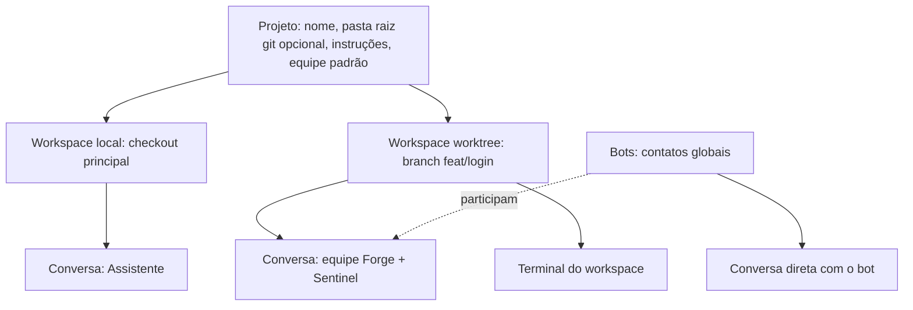

# Estratégia Politron: Paseo + OpenMausBot

Data: 16/10/2026. Este documento é a fonte de verdade do projeto a partir de agora. Substitui `PLANO_V9.md` e `ESTRATEGIA_CHAT_V9.md` como guia de execução; as decisões de produto desses dois continuam valendo onde não forem contrariadas aqui.

## 1. Objetivo

Politron é um aplicativo desktop (Electron, Windows) para programar com agentes, no estilo ChatGPT/Codex Desktop, que junta:

- **De Paseo** (https://github.com/getpaseo/paseo, Apache-2.0): organização centrada em código. Projeto, workspaces (checkout local ou worktree com branch própria), terminal por workspace, diff e mudanças do repositório à vista, badge de "precisa de atenção", seletor `motor/modelo`, perfis de agente.
- **De OpenMausBot** (https://github.com/milind-soni/OpenMausBot, Apache-2.0 exceto `enterprise/`): organização centrada em conversa. Bots como contatos com identidade própria, clique abre o chat, grupos com vários bots, delegação explícita entre bots, Chief que administra a equipe por ferramentas internas, aprovações inline no chat.

Resultado esperado para o usuário: abrir o app, escolher um projeto, abrir um workspace, conversar com o Assistente padrão, com um bot ou com uma equipe, ver os arquivos alterados como diff dentro do chat, usar terminal e navegador do mesmo workspace, e acompanhar várias frentes em paralelo sem que uma pise na outra.

## 2. Modelo de domínio unificado

| Entidade | Origem | Regras |
| --- | --- | --- |
| **Bot** (`Agent`) | MausBot | Identidade (nome, avatar, cor, descrição), instruções, motor e modelo, permissões (`canWrite`, `computerUse`, modo de aprovação). Global, não pertence a projeto. Clique abre conversa direta; editar perfil é ação separada. |
| **Assistente** | GPT Desktop | Perfil embutido (`ASSISTANT_ID`), sem cadastro. Responde quando a conversa não tem participantes. |
| **Projeto** | Paseo | Nome obrigatório; pasta raiz opcional (sem pasta = só conversa). Instruções compartilhadas, equipe padrão opcional. |
| **Workspace** | Paseo | Pertence a um projeto com pasta. `kind: 'local' \| 'worktree'`, `path`, `branch`, `baseBranch`, `archived`. Todo projeto com pasta ganha automaticamente um workspace `local`. Worktree é opcional, criado pelo usuário para isolar uma frente de trabalho. |
| **Conversa** | Ambos | Pertence a um workspace, a um projeto sem pasta ou a nada (avulsa/direta). Participantes próprios (zero = Assistente, um = só ele, vários = grupo). Título automático. |
| **Run / Sessão** | V9 atual | Sessão por conversa + participante + motor + revisão de contexto. Nunca compartilhada entre conversas. |
| **Delegação** | MausBot + V9 | `ask_agent` com estado durável, deduplicação, cancelamento, sem ciclos (já implementado). |
| **Alteração de arquivo** (`FileChange`) | Paseo | Registro persistido de cada escrita real com diff anterior/posterior, autor, run, estado. |
| **Concessão Chief** | MausBot | Capacidade administrativa opcional dada a um bot, com escopo. Última fase. |

Regras de conversa que já valem e não mudam: mensagem humana sem menção aciona todos os participantes ativos; com menção, só os citados; respostas de bots não iniciam nova rodada; mudar participantes vale para o próximo envio, nunca redireciona turno em andamento.

**Conflito de nomes:** hoje `WorkspaceService`, `WorkspaceAPI`, `workspaceAPI` e `features/workspace/Workspace.tsx` designam o app inteiro. Na Fase 0 renomear para `AppService`, `AppAPI`, `appAPI` e `features/app/AppShell.tsx`, liberando "Workspace" para o conceito do Paseo.

## 3. Layout

Manter tokens, fontes e os 14 temas atuais. Mudança é de hierarquia, não de identidade visual.

- **Barra lateral esquerda**, de cima para baixo:
  1. Botão **Nova conversa** (Assistente, sem projeto).
  2. **Projetos**: árvore Projeto > Workspaces (ícone de branch, nome da branch, badge de atenção, fixar, arquivar) > Conversas. Ação "Novo workspace" no menu do projeto (local já existe; criar worktree pede nome da branch e base).
  3. **Bots**: lista de contatos com avatar, status (ocioso, trabalhando, aguardando aprovação) e não lidas. Clique abre a conversa direta mais recente; menu de contexto: Nova conversa, Editar perfil, Promover a Chief (Fase 8).
- **Centro**: chat. Cabeçalho mostra `Projeto / workspace (branch) · título · chips dos participantes · motor/modelo`. Atividades de delegação aparecem como cartões ligados à conversa do destinatário.
- **Painel direito sob demanda** (abas): Arquivos alterados (diff), Terminal, Navegador, Detalhes da conversa.
- **Configurações**: tela própria (motores e binários, modelos padrão, tema, pasta de worktrees). Hoje `/settings` cai no mesmo componente principal.
- **Atenção** (Paseo): quando um run termina ou pede aprovação fora da conversa aberta, badge na conversa, no workspace e no bot, e notificação do Windows.

## 4. Estado atual (verificado em 16/10/2026)

- `master` em `9336c16`. A branch `v9/assistente-projetos` e o worktree `politron-v9-slice` foram unificados em `master` e removidos. Backups do estado anterior do working tree: refs `refs/backup/master-wt-2026-10-16` e `refs/backup/master-index-2026-10-16`.
- Pilha ativa (V9): `apps/desktop/src/main/v9/*`, `src/shared/v9.ts`, `src/renderer/src/features/workspace/Workspace.tsx` (173 linhas densas). Motor único: Codex via `codex app-server` (JSON-RPC stdio), ferramentas próprias por `dynamicTools`, sandbox `read-only`, shell desligado. SQLite `politron-v9.sqlite` esquema 3 com backup na migração.
- Feito: Assistente padrão, projetos com várias conversas e equipe padrão, broadcast/menções, `ask_agent` entre conversas com estado durável, navegador controlado pelo agente.
- Falta: clique no bot abrir chat, diff no chat, workspaces/worktrees, terminal ligado ao workspace (hoje recebe qualquer `cwd` do renderer e depende de `activeTeamAtom` legado), aprovações inline, motor Claude, Chief, tela de configurações.
- Testes: `cd apps/desktop/src/renderer && npx vitest run` dá 62 passando, 1 pulado (integração Codex real, `POLITRON_RUN_CODEX_INTEGRATION=1`), 3 falhando, todos legados (CEO/Tech Lead).
- Bagunça: pilha legada inteira (OpenCode SDK, CEO, pipeline, team-store, 60 handlers IPC em `ipc/handlers.ts`) continua sendo inicializada em `src/main/index.ts:174-189` sem ser usada pela UI; `package.json` aninhado em `src/renderer` com as dependências reais do front; `apps/desktop/package.json` sem `test`/`typecheck`; typecheck amplo com erros; mais de 12 MB de artefatos legados (`.opencode/`, `.vendor/agency-agents`, `.sisyphus/`, `specs/`, mockups).

## 5. Plano de execução

Cada fase termina com commit em `master`, testes verdes, typecheck limpo e evidência registrada na seção 7. Não começar uma fase com a anterior vermelha.

### Fase 0: Limpeza e base única

Objetivo: só existe uma pilha, ela compila sem erros e os testes refletem o produto.

1. Criar tag `legado-pre-limpeza` no commit atual antes de apagar qualquer coisa. O histórico do Git é o arquivo; não copiar código legado para pastas `legacy/`.
2. Remover do processo principal: registro de `registerHandlers()` legado, `appStateDb.init`, `pipelineExecutor.hydrate`, `teamStore.hydrate`, ajuste de PATH do OpenCode e o bloco `POLITRON_ENABLE_LEGACY`. Preservar só o IPC do terminal e o que a V9 usa (confirmar com grep antes).
3. Apagar a pilha legada que nada da V9 importa: `services/opencode-sdk.ts`, `ceo-*`, `pipeline-executor`, `entry-point-router`, `agent-capability`, `agent-catalog`, `internal-agents`, `internal-tools/`, `team-store`, `session-store`, `task-tool-bridge`, `provider-router`, `agency-agent-sync`, `config/features.ts`, `types/ceo`, `types/team`; no renderer `features/chat/*` (exceto `DiffViewer.tsx`, `DiffCard.tsx`, `FileChangesCard.tsx`, mover para `features/diff/`), `features/group-chat/*`, `pages/Index.tsx`, `hooks/useWorkspace.tsx`, `components/ide/*` exceto `TitleBar`, `ThemeSelector`, `TerminalPanel`, `components/setup`, `SettingsScreen.tsx` antigo. Apagar os testes legados correspondentes. Antes de cada remoção, `grep` de importações.
4. Apagar artefatos: `.opencode/`, `.vendor/agency-agents`, `.sisyphus/`, `specs/`, `scripts/convert-agency-opencode.mjs`, `package-lock.json` vazio da raiz, `vibecoding_ide_mockup.html`, `apps/desktop/tmp-electron-global.cjs`, `test-electron.ps1`, `src/renderer/dist`, mocks e componentes `ui/*` sem importação.
5. Mover documentos históricos para `docs/arquivo/`: `PLANO_V9.md`, `ESTRATEGIA_CHAT_V9.md`, `OPENMAUSBOT_REFERENCIA.md`, `PROMPT_LUNA_V9.md`, `CHAT_DESIGN_INPUT_Version2.md`, `REAPROVEITAMENTO_ARQUITETURA_Version2.md`, `PAPERCLIP_ANALYSIS.md`, `vibecoding-ide-prompt.md`. Raiz fica com `AGENT.md`, `PRODUCT.md`, `ESTRATEGIA_POLITRON.md`. Atualizar `AGENT.md` para apontar para este documento.
6. Unificar pacotes: um único `apps/desktop/package.json` com todas as dependências do main e do renderer; remover `src/renderer/package.json` e seu `node_modules`; mover `vitest.config.ts` para `apps/desktop`. Scripts: `dev`, `build`, `test`, `test:codex` (com a variável de integração), `typecheck`, `lint`. Remover dependências que deixaram de ser importadas (`@opencode-ai/sdk`, `@assistant-ui/*`, `xterm` v5 duplicado de `@xterm/xterm`, `@anthropic-ai/sdk` se só o MiniMax usava).
7. Renomear o conflito de nomes da seção 2 (`WorkspaceService` para `AppService` etc.).
8. Quebrar `Workspace.tsx` em módulos legíveis: `features/app/AppShell.tsx`, `features/sidebar/`, `features/chat/` (lista, mensagem, cabeçalho), `features/composer/`, `features/panels/` (navegador, terminal), `features/editors/` (bot, projeto, conversa). Sem mudar comportamento.
9. `typecheck` cobrindo main, preload, shared e renderer, com `strict: true` ao menos para `main/v9`, `shared` e o renderer novo.

Aceite: `npm ci && npm run typecheck && npm test && npm run build` em `apps/desktop` sem erro; app abre com `npm run dev`; conversa com Assistente via Codex real responde; integração `npm run test:codex` passa.

### Fase 1: Navegação MausBot + Paseo

1. Barra lateral conforme seção 3 (Nova conversa, Projetos em árvore, Bots como contatos).
2. Clique no bot abre conversa direta (a mais recente ou cria uma); editar perfil por menu. Conversas diretas também listadas sob o bot.
3. Cabeçalho com projeto, título, chips de participantes (adicionar/remover vale para o próximo envio) e seletor de modelo.
4. Tela de Configurações própria.
5. Estado de cada bot (ocioso, trabalhando, aguardando) e contagem de não lidas.

Aceite: teste de renderer para clique no bot abrindo chat; roteiro manual com captura de tela em 3 temas (claro, escuro, um colorido).

### Fase 2: Workspaces e worktrees (Paseo)

1. Domínio: `Workspace { id, projectId, kind, path, branch, baseBranch, archived, createdAt }`; `Conversation.workspaceId` substitui `directory`. Migração de esquema 3 para 4 com backup: cada projeto com pasta ganha workspace `local`; conversas com pasta são associadas a ele; conversas avulsas com pasta mantêm um workspace local implícito do diretório.
2. Serviço de worktree no main: criar com `git worktree add -b <branch> <userData>/worktrees/<projeto>/<slug> <base>`; listar; arquivar removendo o worktree só se limpo (se sujo, perguntar). Pasta raiz precisa ser repositório git; sem git, só workspace local.
3. Fila de escrita por caminho canônico continua; worktrees diferentes rodam em paralelo.
4. Terminal por workspace: o main resolve o `cwd` a partir do `workspaceId`, nunca aceita caminho vindo do renderer. Remover dependência de `activeTeamAtom`.
5. Badge de branch e de mudanças pendentes (`git status --porcelain` contado) no workspace.

Aceite: testes de store para migração 3 para 4 (com backup e recusa de esquema futuro); testes do serviço de worktree contra um repositório temporário; duas conversas em worktrees diferentes escrevendo em paralelo sem conflito; terminal abrindo na pasta certa.

### Fase 3: Diff no chat

Seguir a seção "Alterações de arquivo dentro do chat" de `docs/arquivo/ESTRATEGIA_CHAT_V9.md`, resumida:

1. `workspace_write` lê o conteúdo anterior, grava, lê o posterior e cria `FileChange { id, runId, messageId, toolCallId, agentId, workspaceId, path, status: 'applied' | 'failed' | 'unknown' | 'unchanged', before, after, additions, deletions, truncated, binary }` com chave de deduplicação `runId + toolCallId`. Persistir em tabela própria.
2. Cartão "Arquivos alterados" por turno no chat, reaproveitando `DiffViewer.tsx` (`@pierre/diffs`) e adaptando `DiffCard`/`FileChangesCard` para o novo registro, sem store legado.
3. Painel direito "Arquivos alterados" do workspace (estilo Paseo): diff atual do workspace contra `HEAD`.
4. Sem desfazer nesta fase.

Aceite: testes para criação, edição, falha, ausência de mudança, evento repetido, dois autores, arquivo grande/binário, recuperação após reinício.

### Fase 4: Aprovações inline e atenção

1. Modo de aprovação por bot e pelo Assistente: `perguntar` (padrão) ou `automático` para escrita e navegador.
2. Com `perguntar`, a ferramenta suspende o run, mostra cartão inline no chat com o diff proposto e botões Aprovar/Negar (MausBot); estado `waiting` já existe em `RunStatus`.
3. Badges de atenção (seção 3) e notificação do Windows quando run termina ou pede aprovação fora da conversa visível.
4. Mensagem enviada durante um turno em andamento entra em fila para o próximo turno, com indicação visual.

Aceite: testes de aprovação, negação, cancelamento durante espera, reinício com aprovação pendente (vira `interrupted`, sem replay).

### Fase 5: Segundo motor (Claude)

1. Extrair interface `AgentRuntime` (`thread`, `send`, `interrupt`, `models`, eventos normalizados) a partir de `codex.ts`; `CodexRuntime` passa a implementá-la; `WorkspaceService`/`AppService` passa a depender da interface.
2. `ClaudeRuntime` com `@anthropic-ai/claude-agent-sdk`: ferramentas do Politron expostas por servidor MCP em processo (`createSdkMcpServer`); bloquear ferramentas nativas de escrita e shell (`Write`, `Edit`, `Bash`, `NotebookEdit`) para que toda escrita passe por `workspace_write` e gere diff; `cwd` = pasta do workspace; retomar sessão pelo id persistido.
3. `Agent.runtime: 'codex' | 'claude'`; seletor `motor/modelo` no editor do bot e no composer; validação no store.
4. Perfis (Paseo): presets nomeados de motor, modelo e esforço para criar bots rápido.

Aceite: os testes de conversa, delegação e diff rodam com os dois runtimes simulados; integração real Claude condicionada (`POLITRON_RUN_CLAUDE_INTEGRATION=1`) cobrindo resposta, escrita com diff e `ask_agent` de Claude para Codex.

**Marco: com as Fases 0 a 5 concluídas o app está pronto para uso diário.**

### Fase 6: Perguntar a pessoas pelo Discord

Decisão do usuário em 16/10/2026: pessoas não entram no Politron; são consultadas por integração externa. Caso de uso: no meio de uma tarefa surge uma dúvida, o usuário ou um bot pergunta ao Fulano no Discord e a resposta volta para a conversa.

1. **Pessoas** em Configurações: `Person { id, name, channel: 'discord', discordUserId, discordChannelId? }`. Aparecem como contatos na lateral (seção separada dos bots), sem conversa própria no Politron.
2. **Conexão:** bot do Discord criado pelo usuário no Developer Portal; token guardado com `safeStorage` do Electron, nunca no SQLite em texto puro nem em log. O main conecta pelo gateway (`discord.js`), sem servidor do Politron. Envio por DM ou por thread num canal configurado (DM falha se a pessoa não compartilha servidor com o bot ou bloqueia DMs: mostrar o erro real).
3. **Perguntar:** o usuário menciona `@Fulano` no composer ou um bot chama a ferramenta `ask_person(personId, question)`. Antes de sair, cartão inline mostra exatamente o texto que será enviado, com Enviar/Editar/Cancelar. Enviar para fora é publicação; nunca enviar automaticamente na primeira versão. Só vai o texto da pergunta, nunca código, caminhos ou transcript sem o usuário incluir.
4. **Esperar:** o run fica `waiting` com cartão "Aguardando Fulano no Discord", com cancelamento e prazo configurável. A resposta (reply na DM ou mensagem na thread) chega como mensagem de autor humano externo na conversa e é devolvida ao bot como resultado da ferramenta.
5. **Reinício:** pergunta pendente é persistida com o id da mensagem do Discord. Ao reabrir, o app busca no Discord as respostas que chegaram enquanto estava fechado e as coloca na conversa. O run original vira `interrupted` (sem replay); o usuário decide continuar.
6. **Extensível:** interface `ExternalChannel` (`send`, `onReply`, `fetchReplies`) para Slack ou e-mail depois; só Discord agora.

Aceite: testes com canal simulado para envio, resposta, prazo, cancelamento, resposta recebida com app fechado, token ausente ou inválido; um teste manual real com um servidor de teste do Discord, registrado com captura.

### Fase 7: Equipe

1. Conversas internas de delegação aparecem como atividades relacionadas da conversa de origem (trilha de subagentes do Paseo), fora da lista principal, com link para o histórico do destinatário.
2. Grupo com respondedor padrão opcional e quadro de contexto compartilhado (bulletin do MausBot), editável, injetado como contexto dos participantes.
3. Equipe padrão do projeto aplicada ao criar conversa no projeto ou no workspace.

### Fase 8: Chief

Implementar conforme a seção "Chief" de `docs/arquivo/ESTRATEGIA_CHAT_V9.md`: concessão com escopo pelo usuário, ferramentas tipadas sobre os mesmos serviços da UI (criar/editar bot, projeto, workspace, participantes, modelo), `post_to_room` sem disparar turnos versus delegação que dispara, recibos duráveis, identidade do chamador resolvida pelo broker. Referência de contratos: `server/chief-of-staff.ts` e `server/drivers/agents-proxy.ts` no repositório do OpenMausBot.

### Depois do produto utilizável (não fazer agora)

Agendamentos e heartbeats (Paseo), scripts de workspace com porta e proxy (`politron.json`), instalador e atualização automática, acesso pelo celular, voz, plugins.

**Chat interno com pessoas (fora de escopo, decisão do usuário em 16/10/2026).** Pessoas com conta e acesso dentro do Politron, no estilo Slack, exigiriam servidor, contas, sincronização e permissões. A necessidade real (tirar dúvida com alguém no meio da tarefa) é atendida pela Fase 6 via Discord. Precaução desde já: não assumir no código que o único humano é o dono do app. Mensagens referenciam um autor participante (dono, pessoa externa ou bot), e nenhuma regra de roteamento depende de "existe só um usuário".

## 6. Regras para quem executar

- Trabalhar direto em `master` no diretório `D:\projetos pessoais\politron`. Não criar branch nem worktree do Git para desenvolver; o usuário quer tudo junto. (Worktree como funcionalidade do produto na Fase 2 é outra coisa.)
- Git nesta máquina exige `git -c safe.directory=* <comando>` ou rodar uma vez `git config --global --add safe.directory "D:/projetos pessoais/politron"`.
- Ao iniciar: `bright-memory ensure` na raiz. Ao terminar cada fase: `bright-memory save` com resumo durável. Nunca editar `.bright-memory.json`.
- Commits pequenos, mensagem em português com acentuação correta, um ou mais por fase. Nunca usar `--no-verify`.
- Antes de apagar arquivo, confirmar com `grep` que nada ativo importa. Antes de mexer em banco, migração com backup e teste.
- Não declarar uma fase concluída sem: testes verdes, typecheck limpo, build ok e, para mudanças visíveis, o app aberto com captura de tela. Teste com runtime simulado não prova motor real; dizer qual foi qual.
- Código do Paseo e do OpenMausBot (Apache-2.0) pode ser portado quando poupar trabalho real, mantendo o aviso de copyright em `THIRD_PARTY_NOTICES.md`. Nunca copiar nada de `enterprise/` do OpenMausBot. Preferir reimplementar o padrão quando o código depende da arquitetura deles (daemon, Expo, relay).
- Preservar Electron, os 14 temas, tokens e fontes.
- Parar e perguntar ao usuário só se algo deste documento for impossível ou contraditório com o código; nos demais casos, decidir e registrar a decisão na seção 7.

## 7. Registro de progresso

Atualizar a cada fase: data, commit, o que foi provado (testes, integração real, captura), o que ficou pendente.

| Fase | Estado | Commit | Evidência | Pendências |
| --- | --- | --- | --- | --- |
| 0 Limpeza | em validação | commits `9fdb67a` a `0b78d2b` | `npm ci` concluído; `npm run typecheck` passou; `npm test` passou (18 aprovados, 1 integração pulada); `npm run test:codex` passou (19 aprovados); `npm run build` passou; `npm run dev` compilou main/preload e registrou janela mostrada | Captura de tela não obtida: a sessão não expõe janela nativa nem navegador pelo Computer Use. `npm run lint` falhou com 26 erros e 7 avisos. O teste real emite aviso EPERM ao tentar remover diretório temporário, apesar de passar. Build emite avisos de PostCSS e diretivas `use client`. |
| 1 Navegação | pendente | | | |
| 2 Workspaces | pendente | | | |
| 3 Diff | pendente | | | |
| 4 Aprovações | pendente | | | |
| 5 Claude | pendente | | | |
| 6 Discord | pendente | | | |
| 7 Equipe | pendente | | | |
| 8 Chief | pendente | | | |
