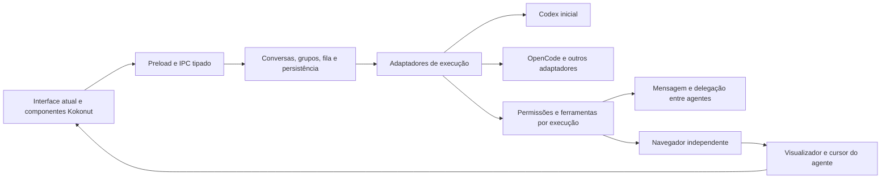

# Plano de execução da V9

Data: 16/10/2026. Base: `D:\projetos pessoais\politron`. Estado deste documento: implementação iniciada; a primeira fatia vertical passou por provas manuais reais, mas os critérios de saída da primeira versão utilizável seguem incompletos.

## 1. Resultado esperado

Transformar o desktop existente em uma ferramenta pessoal de trabalho com agentes personalizados, conversas individuais, grupos associados a pastas, colaboração real e navegador controlado pelos agentes. Preservar a aparência que o usuário construiu.

Fluxo de referência: criar “Implementador” e “Revisor”, montar o grupo “Meu projeto”, selecionar uma pasta, solicitar uma alteração, acompanhar os agentes, receber uma revisão delegada e ver o navegador testar o resultado com seu cursor próprio. Fechar e reabrir o aplicativo deve preservar o trabalho e o histórico.

Atualização de prioridade em 16/10/2026: o usuário deve conseguir iniciar uma conversa, inclusive em um projeto, sem cadastrar bot ou criar grupo. Um projeto organiza várias conversas e pode usar somente um bot ou uma equipe. Edições reais de arquivos mostram diff dentro do chat. A estratégia proposta e a ordem do incremento estão em [ESTRATEGIA_CHAT_V9.md](<D:/projetos pessoais/politron/ESTRATEGIA_CHAT_V9.md>). A fatia inicial de Assistente e conversas por projeto foi implementada em um worktree isolado; diff no chat e validação real/visual seguem pendentes.

O usuário acrescentou Chief opcional: promover um bot para administrar a plataforma por ferramentas internas, criar/configurar bots e grupos, mudar modelos e atuar em grupos autorizados a partir de pedidos no privado. Incluir concessões de administração, serviços compartilhados com a UI, publicações sem broadcast e recibos persistidos entre conversas. O termo correto é Chief. Detalhamento e prova de saída estão na estratégia; não há implementação certificada dessa capacidade na V9.

Requisitos de produto confirmados: [PRODUCT.md](<D:/projetos pessoais/politron/PRODUCT.md>). A referência de colaboração destacada pelo usuário está em [OPENMAUSBOT_REFERENCIA.md](<D:/projetos pessoais/politron/OPENMAUSBOT_REFERENCIA.md>). Instruções de execução para Luna: [PROMPT_LUNA_V9.md](<D:/projetos pessoais/politron/PROMPT_LUNA_V9.md>).

## 2. Regras da evolução

- Preservar layout, temas, fontes, acabamento, dimensões e painéis existentes. Acrescentar recursos dentro dessa linguagem visual.
- Trocar partes específicas do chat pela Kokonut UI. A biblioteca fornece componentes de interface; a execução e a colaboração precisam de serviços próprios.
- Manter Electron e a stack que efetivamente funciona no repositório. Não combinar esta entrega com migração de framework, roteador ou gerenciador de estado.
- Usar Codex como primeiro motor do novo fluxo. Reaproveitar OpenCode/MiniMax quando viável, por adaptadores, sem exigir que todos os motores sejam entregues juntos.
- O nome provisório na interface é “agente”. Evitar apresentar dots, bots e agentes como produtos diferentes.
- Grupos são livres; cargos antigos não são pré-requisitos de criação, conversa ou delegação.
- Navegador independente entra na primeira versão utilizável. Programas do Windows entram depois, conforme escolha do usuário.
- “V9” identifica esta evolução. Não alterar automaticamente o manifesto para `9.0.0`.

O [AGENT.md legado](<D:/projetos pessoais/politron/AGENT.md>) e as specs antigas descrevem outro produto, com CEO e tech lead obrigatórios. Essas regras de organização foram substituídas pelas instruções diretas atuais do usuário. A etapa 0 deve reconciliar a documentação de implementação com esta decisão, preservando as orientações técnicas ainda válidas.

## 3. Estado real encontrado

Inspeção estática do código em 16/10/2026; funcionamento ponta a ponta permanece por validar.

| Área | Evidência | Consequência para o plano |
| --- | --- | --- |
| Desktop e layout | [Index.tsx](<D:/projetos pessoais/politron/apps/desktop/src/renderer/src/pages/Index.tsx>) organiza lateral, chat e terminal redimensionáveis | Reaproveitar a composição; adaptar navegação e cabeçalhos |
| Temas | [ThemeSelector.tsx](<D:/projetos pessoais/politron/apps/desktop/src/renderer/src/components/ide/ThemeSelector.tsx>), [ThemeProvider](<D:/projetos pessoais/politron/apps/desktop/src/renderer/src/components/theme-provider.tsx>) e [index.css](<D:/projetos pessoais/politron/apps/desktop/src/renderer/src/index.css>) | Preservar os 14 temas e a preferência salva de aparência |
| Chat individual | [AgentChatShell.tsx](<D:/projetos pessoais/politron/apps/desktop/src/renderer/src/features/chat/components/shell/AgentChatShell.tsx>) e [useOpencodeTranscriptBridge.ts](<D:/projetos pessoais/politron/apps/desktop/src/renderer/src/features/chat/hooks/useOpencodeTranscriptBridge.ts>) ligam sessões, eventos e cartões | Extrair contrato comum de execução e conservar os renderizadores úteis |
| Grupos | [GroupChatProvider.tsx](<D:/projetos pessoais/politron/apps/desktop/src/renderer/src/features/group-chat/GroupChatProvider.tsx>) usa estado React, recria canais ao mudar o time e não inicia runtimes; não está montado no fluxo principal | Implementar persistência e despacho real antes de considerar chat coletivo pronto |
| Motores | [provider-router.ts](<D:/projetos pessoais/politron/apps/desktop/src/main/services/provider-router.ts>) contém `opencode` e `minimax`, com distinção entre internos e executores | Adicionar adaptador Codex; retirar a dependência de cargo para escolher motor |
| Colaboração | [delegation-tools.ts](<D:/projetos pessoais/politron/apps/desktop/src/main/services/internal-tools/delegation-tools.ts>) e serviços OpenCode/CEO já tratam delegação e eventos | Reaproveitar ideias e contratos úteis; desacoplar cargos, time e pipeline obrigatório |
| Dados | [app-state-db.ts](<D:/projetos pessoais/politron/apps/desktop/src/main/services/app-state-db.ts>) usa SQLite para times, agentes e tarefas; [session-store.ts](<D:/projetos pessoais/politron/apps/desktop/src/main/services/session-store.ts>) mantém sessões em memória, centradas em agente | Acrescentar entidades de conversas, grupos e vínculos de sessão com migração |
| Concorrência | [file-lock.ts](<D:/projetos pessoais/politron/apps/desktop/src/main/services/file-lock.ts>) mantém locks cooperativos em memória | Não presumir que protege escritas de shell/runtime; coordenar execução por pasta |
| Computer Use | A inspeção não encontrou serviço de navegador controlado ou ponte de Computer Use; há apenas referências de menu a browser | Entregar serviço, ferramentas, permissões, visualizador e prova real |
| Versões | Manifestos declaram Electron 40; renderer usa React 18.3, React Router 6, Vite 5 e Tailwind 4, divergindo do texto do AGENT.md | Confirmar versões instaladas e manter a stack real durante esta evolução |
| Prévia | [TitleBar.tsx](<D:/projetos pessoais/politron/apps/desktop/src/renderer/src/components/ide/TitleBar.tsx>) acessa `window.vibeAPI.platform` diretamente | Validar principalmente no Electron; tratar ausência da ponte sem uma tela branca inexplicável |

O Codex CLI local respondeu `0.160.1`; seu `app-server --help` identifica a integração como experimental. Isso confirma disponibilidade do comando, não autenticação, capacidade de ferramentas ou execução bem-sucedida.

Foram encontrados 45 caminhos com alterações staged anteriores a este plano. Não misturar, reverter, limpar, fazer checkout ou commitar esse trabalho como parte automática da evolução. Registrar o estado inicial e preservar o índice.

### Progresso da implementação em 16/10/2026

O início substituiu no [AGENT.md](<D:/projetos pessoais/politron/AGENT.md>) as regras legadas de CEO e tech lead obrigatórios. O novo fluxo fica na janela Electron principal; os dados V9 ficam em `politron-v9.sqlite`, sem alterar o banco antigo. Os arquivos staged preexistentes não foram adicionados, revertidos ou limpos.

A fatia implementada inclui cadastro de agentes, instruções, modelo Codex, avatar estático e permissões de escrita/Computer Use; conversas individuais e grupos com pasta; histórico e estados de execução; broadcast sem menção; fila por pasta; delegação com profundidade e ciclos limitados; ferramentas de arquivo limitadas à pasta; seletor de modelo real; campo de mensagem Kokonut; visualização de navegador Playwright isolado, ações reais, cursor identificado e controle humano; terminal contextual ao diretório do grupo.

Provas manuais em perfil temporário do Electron confirmaram um turno real do Codex com texto e streaming, duas respostas em um grupo sem menção, delegação de A para B visível como atividade, e um agente com Computer Use abrindo `example.com`, clicando em um link e atualizando a tela do navegador com cursor rotulado. O build de produção Electron Vite passou; a verificação TypeScript focada nos módulos V9 passou. A captura após a mudança mostra a nova tela com o tema existente. Esses resultados confirmam caminhos específicos e não substituem os critérios abaixo.

Ainda faltam: prova após reiniciar com os mesmos dados, teste de menção, exercício efetivo de leitura/escrita no projeto e dos limites contra junctions, cancelamento/retomada e recuperação de falhas, cenário do mouse humano em outro aplicativo durante o uso do navegador, revisão de desligamento do Computer Use, checagem dos 14 temas, baseline e medida de desempenho, integração de empacotamento Windows e execução instalada. Programas nativos do Windows permanecem na etapa seguinte. A primeira versão utilizável não está concluída.

## 4. Experiência e navegação

### Correção de direção em 16/10/2026

O usuário esclareceu que gosta do funcionamento do OpenMausBot e quer conversar diretamente com um bot. Acrescentou os recursos desejados: conversa dentro de projeto sem cadastro obrigatório de bot/grupo, várias conversas por projeto, equipe opcional com um ou mais bots e diffs de edições dentro do chat. A inspeção do aplicativo aberto confirmou que selecionar um bot já abre seu chat, com perfil em ação separada e conversas próprias acessíveis na lateral. No incremento atual, a tela oferece Nova conversa com Assistente, projetos com conversas próprias e controles de equipe opcional; clicar em um agente ainda abre edição. Portanto, a conversa imediata com Assistente e o domínio de projetos têm implementação inicial, enquanto a abertura direta de conversa ao clicar no bot, diffs V9 e validação visual permanecem pendentes.

### Estrutura existente

- Manter a lateral e sua linguagem visual. Organizar nela “Conversas”, “Grupos” e acesso a “Agentes”, aproveitando o espaço e os padrões atuais.
- Preservar painel central, terminal, redimensionamento, seletor de temas e controles de janela. Persistir a preferência de abertura dos painéis.
- Grupos mostram nome, participantes e pasta no cabeçalho. A pasta abre no explorador e contextualiza terminal e execução.
- O painel lateral de ferramentas recebe uma visualização “Navegador”, junto ao terminal, sem impor uma quarta coluna permanente.
- Sessões e histórico devem ser alcançáveis pelos controles atuais; evitar criar uma segunda navegação concorrente de conversas.

### Cadastro de agente

Campos básicos: nome, descrição curta, instruções, motor/modelo, avatar e opção “Uso do computador”. Configurações adicionais ficam recolhidas. Mostrar somente modelos e capacidades que o motor informa e que a integração suporta.

Avatares podem começar com um bot estático e personalização de cor, seed e imagem enviada. O cadastro não pode depender de gerar uma imagem por IA.

### Criação de grupo

Nome, seleção de agentes existentes e seletor nativo de pasta. A pasta é opcional para conversa; ações de desenvolvimento exigem uma pasta explicitamente selecionada. O mesmo agente pode participar de vários grupos, com sessões e permissões efetivas próprias.

Renomear ou arquivar um grupo não altera nem apaga a pasta. Trocar sua pasta exige encerrar ou interromper as execuções ligadas à anterior e criar novos vínculos de sessão; preservar o histórico com a pasta de cada execução registrada.

### Chat utilizável

- Enviar mensagem, receber resposta progressiva, interromper, tentar novamente com contexto claro e continuar a conversa depois de reabrir o aplicativo.
- Markdown, código, arquivos e resultados de ferramentas reais. Anexos só aparecem como suportados quando chegam ao motor; não limitar a troca a exibir chips visuais.
- Enter envia, Shift+Enter quebra linha; respeitar composição de texto e navegação por teclado.
- Identificar agente em cada resposta e delegação. Estados: na fila, executando, aguardando aprovação, concluído, interrompido e erro.
- Preservar o texto em falhas. Não mostrar “online” ou “concluído” por efeito decorativo.
- Ao rolar para cima, não forçar a rolagem para o fim durante o streaming; manter o botão de novas mensagens.
- Trocar de conversa não cancela nem redireciona o trabalho em andamento.

## 5. Domínio, sessões e persistência

Entidades mínimas propostas, a implementar no armazenamento existente com migrações versionadas:

| Entidade | Responsabilidade |
| --- | --- |
| Agent | Identidade, instruções, runtime/modelo, avatar, permissões e revisão da configuração |
| Group | Nome, pasta canônica opcional, revisão da pasta, estado ativo/arquivado |
| GroupMember | Liga agente a grupo; permite configuração contextual sem duplicar a identidade |
| Conversation | Conversa direta ou vinculada a grupo, histórico e título |
| Message | Autor, conteúdo/blocos, destinatários, resposta relacionada, anexos e data |
| Run | Execução real com IDs, motor, estado, snapshot das instruções/pasta/permissões, erro e resultado |
| SessionBinding | Liga conversa + agente + runtime + revisão da pasta ao identificador de sessão do motor |
| Delegation | Origem, destino, execução pai, pedido, estado e resultado |
| ToolGrant / Approval | Acesso efetivo e aprovações vinculadas à execução e à ação |
| BrowserSession | Navegador, páginas, contexto, agente/grupo responsável e proprietário do controle |

Não usar apenas `agentId` como chave de sessão ou um `currentAgentId` mutável global para atribuir respostas. Eventos devem carregar `conversationId`, `groupId` quando houver, `agentId`, `runId`, `eventId` e sequência por execução. Correlacionar também pedidos de ferramentas e delegações.

Persistir mensagens e resultados sem esperar o encerramento de uma conversa. Reabrir o aplicativo deve restaurar o histórico, deduplicar eventos repetidos e marcar execuções incompletas como interrompidas/recuperáveis. Não repetir automaticamente ações que possam já ter produzido efeitos.

Criar backup antes da migração. Importar times existentes como grupos e preservar agentes, históricos e caminhos disponíveis. Converter cargos em metadados opcionais, sem apagar agentes antigos por terem nomes como CEO. Testar migração e restauração em uma cópia dos dados.

## 6. Motores e ferramentas

O renderer apresenta e solicita ações. Processos, acesso a disco, runtime, banco, permissões e controle do navegador ficam no main ou em workers dedicados, acessados pelo preload tipado.

Contrato dos adaptadores: verificar disponibilidade/autenticação, informar modelos/capacidades, iniciar ou retomar sessão, enviar turno, transmitir eventos, interromper, responder aprovação e encerrar recursos. Normalizar esses eventos antes de enviá-los à interface.

Para Codex, validar `app-server` por transporte local stdio e os bindings compatíveis com a versão instalada. A documentação oficial apresenta sessões, eventos, interrupção e aprovações como parte da integração; o protocolo e as ferramentas disponíveis devem ser verificados na versão local. [Documentação do app-server](https://learn.chatgpt.com/docs/app-server).

Conectar as ferramentas de colaboração e navegador por um mecanismo suportado pelo runtime, como um servidor MCP local com contexto autenticado por execução. Provar que o modelo realmente recebe, chama e utiliza essas ferramentas. Apenas colocar instruções no prompt ou exibir um botão não entrega a integração.

Não reaproveitar tokens privados do aplicativo ChatGPT/Codex Desktop. Usar os mecanismos suportados de autenticação/configuração do runtime e validar uma execução real antes de declarar o modelo disponível.

## 7. Roteamento e colaboração real

Regras de despacho:

1. Mensagem humana sem menção: persistir uma vez e criar uma execução para cada participante ativo do grupo.
2. Mensagem humana com menções: executar apenas os participantes resolvidos pelas menções, sem duplicação. Identificadores internos são estáveis; nomes são apresentação.
3. Menção desconhecida ou ambígua: indicar o problema e permitir correção; não enviar silenciosamente para todos.
4. Resposta comum de um agente: publicar no grupo, sem disparar automaticamente todos os outros.
5. Pedido de um agente para outro: chamar ferramenta explícita de mensagem/delegação, iniciar execução do destinatário e publicar a relação na conversa.
6. Resposta à delegação: retornar ao agente solicitante e ao registro visível do grupo, preservando o vínculo com a tarefa original.

Ferramentas conceituais mínimas: listar participantes disponíveis, enviar pergunta direcionada e delegar tarefa com contexto e resultado esperado. Autorizar somente membros do grupo, salvo concessão explícita do usuário. Identidade de origem e grupo são resolvidos pelo serviço; o modelo não pode forjá-los nos argumentos.

Todos recebem o mesmo snapshot da mensagem humana e do histórico até aquele envio. Cada agente mantém sua sessão contextual; respostas posteriores só entram em novas execuções de maneira deliberada. Resumo e janela de contexto devem impedir crescimento ilimitado do prompt, sem inventar memória compartilhada entre grupos.

O orquestrador precisa de fila, limitação de concorrência, cancelamento encadeado, timeout e identificação de ciclos. Defaults técnicos propostos: duas execuções simultâneas, profundidade máxima de três delegações e limite de vinte execuções por demanda original. São limites de operação ajustáveis, não promessas de desempenho.

Como todos podem receber uma demanda ao mesmo tempo, serializar execuções com permissão de escrita por pasta canônica na primeira entrega. A fila deve enxergar grupos diferentes apontando para a mesma pasta. Locks cooperativos atuais não bastam se shell ou runtime puderem ignorá-los. Paralelizar escrita só depois de comprovar mediação efetiva ou isolamento por worktree, sem merge automático obrigatório.

## 8. Computer Use: navegador com cursor próprio

### Primeira entrega, confirmada pelo usuário

Criar um serviço de navegador automatizado por Playwright, iniciado sob demanda fora do renderer. Usar contextos lógicos separados por grupo/conversa e agente, com isolamento de cookies e armazenamento. Não reutilizar automaticamente o perfil do Chrome pessoal. Contextos não equivalem a uma máquina virtual ou isolamento de arquivos do sistema. [Contextos Playwright](https://playwright.dev/docs/browser-contexts).

Controlar páginas e elementos por ferramentas reais de abrir URL, observar, clicar, digitar, rolar, trocar página e capturar a tela. Preferir elementos identificáveis; aceitar coordenadas quando necessário. O mouse do Playwright pertence à página, e fornece a base para entrada independente do ponteiro do Windows. [Mouse por página](https://playwright.dev/docs/api/class-mouse).

Mostrar capturas/frames atualizados no painel existente. A seta com nome e cor do agente acompanha ações reais do serviço. Correlacionar frame, viewport, escala, posição e ação; não desenhar um cursor aleatório para simular funcionamento. Se uma ação por elemento não produz deslocamento real, destacar o alvo em vez de inventar movimento.

Estados do painel: desligado, iniciando, observando, atuando, aguardando usuário, pausado e erro. Controles: acompanhar, parar, assumir controle e devolver controle. Enquanto o usuário assume a sessão, ferramentas do agente ficam suspensas; enviar cliques e teclado do visualizador à mesma página por um único proprietário do controle.

Uma página recebe ações de um agente por vez. Agentes trabalhando em páginas próprias podem progredir em paralelo dentro dos limites; compartilhar página exige passagem explícita de controle. Perfil/sessão persistente é opcional e por contexto, com recuperação e encerramento definidos.

Downloads chegam à pasta autorizada; uploads usam arquivos explicitamente acessíveis naquela execução. Não oferecer acesso irrestrito ao disco por meio da ferramenta de navegador.

Requisitos de conclusão: um agente observa e interage com uma página real, confirma o efeito, informa o resultado no chat e exibe a ação no visualizador, enquanto o usuário continua usando seu mouse. Repetir com outro agente criado pelo usuário e com Computer Use desativado, verificando bloqueio efetivo.

### Etapa seguinte: programas do Windows

Investigar backend de automação de desktop com observação e ações, acompanhado de uma sessão/ambiente isolado quando for necessário garantir entrada independente em aplicativos arbitrários. Não prometer independência universal usando apenas uma segunda seta desenhada sobre a sessão normal do Windows.

O spike deve demonstrar abrir um programa nativo, observar, editar, salvar um arquivo na pasta concedida e mostrar o resultado sem disputar a entrada do usuário. Avaliar requisitos de VM/sessão separada, custo de recursos, compartilhamento de arquivos e limitações reais. Backend e infraestrutura permanecem decisões abertas. Automação do desktop inteiro só pode ser apresentada como disponível depois dessa prova.

Esta etapa permanece no objetivo do produto, mas não bloqueia a primeira versão com navegador, conforme resposta do usuário.

## 9. Permissões e controle

- Todos os agentes recebem a mesma opção de Computer Use, desligada por padrão, com permissão contextual por grupo/conversa.
- Separar acesso à pasta/terminal, navegador e futuro desktop nativo. Configurações globais, contexto e capacidade do adaptador compõem a permissão efetiva; aplicar sempre a mais restritiva.
- Aplicar autorização no serviço de ferramentas e no sandbox/configuração do runtime. `cwd` informa a pasta, mas sozinho não restringe acesso ao disco.
- Validar caminhos canônicos, junctions/symlinks e saída da pasta nos serviços próprios. Quando o runtime tiver ferramentas diretas, provar que sua política também impede contornar a restrição; bloquear o modo restrito se isso não for suportado.
- Desligamento/revogação deve cancelar ações pendentes, impedir novas chamadas e interromper a execução capaz de continuar usando ferramentas. Pedidos em andamento precisam de estado explícito.
- Manter aprovação para ações que a política configurada exige, com identificação de agente, ação e escopo. Aprovar/recusar precisa responder ao runtime e à ferramenta correta.
- Páginas externas não recebem a ponte IPC privilegiada da aplicação; manter separação entre conteúdo remoto e interface local.

Mostrar controles simples na interface; parâmetros técnicos ficam em configurações avançadas.

## 10. Componentes Kokonut e preservação visual

A Kokonut UI é um registry de componentes React/shadcn, com instalação seletiva e Tailwind 4. Usar o `components.json` existente e acrescentar o namespace sem reinicializar shadcn ou sobrescrever o CSS. [Instalação oficial](https://kokonutui.com/docs).

| Parte atual | Candidato verificado | Integração necessária |
| --- | --- | --- |
| Campo de mensagem e controles | [AI Input Selector](https://kokonutui.com/docs/ai/ai-prompt) | Ligar envio, interrupção, anexos reais e menções do grupo; adaptar ao layout atual |
| Seleção de modelo | [AI Model Selector](https://kokonutui.com/docs/ai/ai-model-selector) | Dados e níveis de esforço vêm do adaptador; não usar catálogo demonstrativo |
| Aprovações | [AI Tool Approval](https://kokonutui.com/docs/ai/ai-tool-approval) | Ligar a pedidos reais e respostas correlacionadas, respeitando a política do aplicativo |
| Estado de execução | [AI State Loading](https://kokonutui.com/docs/ai/ai-loading) | Estados guiados pelos eventos; sem progresso ou conclusão fictícios |
| Personalização de avatar | [Avatar Picker](https://kokonutui.com/docs/inputs/avatar-picker) | Avaliar quando o núcleo estiver funcional, com dados e assets próprios |

Preservar os renderizadores existentes de Markdown, código, diff, terminal e ferramentas quando atenderem ao contrato. Não há motivo para reescrever todo o transcript para instalar o campo de entrada.

Os exemplos são ponto de partida, não garantia de compatibilidade, acessibilidade ou ligação ao runtime. Conferir o código e a licença dos componentes escolhidos; fixar versões/fontes usadas e remover textos/modelos de demonstração. Instalar um componente de cada vez e evitar seletores de modelo duplicados.

Componentes novos devem consumir os tokens atuais de tema, incluindo fontes. Preservar `default`, `cafeine`, `candyland`, `claude`, `dark-matter`, `violet-bloom`, `tangerine`, `t3chat`, `cyberpunk`, `terminal-muted`, `omegon`, `msn`, `zen` e `melancholik`, além dos modos claro, escuro e sistema já disponíveis.

## 11. Avatares e pequenas melhorias

Primeiro, identidade estável: avatar estático personalizável, fallback de iniciais/bot e upload com recorte. Sugestão para avaliar: DiceBear Bottts, que documenta cabeças de robôs com partes configuráveis. Gerar localmente, guardar seed/opções e conferir a licença específica do estilo antes de distribuir. [Bottts](https://www.dicebear.com/styles/bottts/).

Depois, expressões discretas ligadas ao estado real: piscar, trabalhando, aguardando e erro. Respeitar redução de movimento e pausar quando a janela não está visível. Não manter uma animação pesada por mensagem no histórico. Não exigir serviço de imagem pago; geração por IA pode ser adicionada sob demanda posteriormente.

Melhorias pequenas já alinhadas ao trabalho diário: busca de histórico, indicador da pasta ativa, botão de abrir a pasta, resumo recolhível de delegações e parada de todas as execuções do grupo. Não acrescentar marketplace, cobrança, cargos empresariais, voz ou infraestrutura de nuvem obrigatória nesta evolução.

## 12. Entregas e critérios de saída

Cada etapa entrega um fluxo vertical funcional. Os checkboxes representam trabalho a executar, não progresso já alcançado.

### 0. Preparar a base e provar a integração

- [ ] Registrar alterações existentes, versões instaladas e comandos de execução; reconciliar orientações legadas com o produto atual.
- [ ] Capturar a aparência real do Electron nos temas existentes e medir abertura, memória dos processos e chat antes de alterar.
- [ ] Validar runtime Codex: autenticação disponível, turno real, streaming, interrupção, retomada e uma ferramenta local contextual.
- [ ] Provar, em uma página controlada de teste, que o serviço de navegador pode agir e produzir observação sem mover o ponteiro do Windows.

Saída: evidências e limites conhecidos. Falha de autenticação é informada como bloqueio real de execução; não substituir por resposta simulada.

### 1. Domínio, dados e agentes

- [ ] Implementar entidades e migrações da seção 5 com backup e teste de restauração.
- [ ] Criar/editar agentes com instruções, motor/modelo, avatar básico e permissões persistidas.
- [ ] Eliminar exigência de cargos no novo fluxo e preservar os dados antigos.

Saída: criar dois agentes comuns, reabrir o aplicativo e recuperar suas configurações sem perda da aparência ou dos dados anteriores.

### 2. Chat individual real com Codex

- [ ] Implementar adaptador e eventos normalizados; ligar ao chat existente.
- [ ] Enviar, transmitir resposta, interromper, continuar e recuperar histórico.
- [ ] Garantir atribuição correta ao trocar de conversa e tratar falhas/aprovações.

Saída: duas conversas independentes, execução real em pasta escolhida e nenhum vazamento de eventos entre elas.

### 3. Grupos, pasta e despacho

- [ ] Criar/editar/arquivar grupo, adicionar/remover participantes e selecionar pasta.
- [ ] Persistir conversa coletiva e sessões por participante/contexto.
- [ ] Implementar regras de menções e envio a todos; fila de escrita por pasta e cancelamento do grupo.
- [ ] Integrar a navegação aos painéis existentes.

Saída: três agentes recebem uma mensagem sem menções; apenas o mencionado executa uma mensagem direcionada; reiniciar preserva grupo, pasta e histórico.

### 4. Agentes colaborando

- [ ] Publicar ferramentas reais de mensagem e delegação para participantes autorizados.
- [ ] Executar destinatário, devolver resultado e apresentar a cadeia no transcript.
- [ ] Controlar profundidade, ciclos, timeout, indisponibilidade e cancelamento encadeado.

Saída: A delega para B, B executa uma alteração verificável, A recebe o resultado e conclui; o usuário acompanha essa cadeia no grupo sem intervir para copiar mensagens.

### 5. Kokonut no chat

- [ ] Integrar campo de mensagem, estados, seleção de modelo e aprovações conforme a seção 10.
- [ ] Manter menções, anexos, atalhos, scroll, cartões úteis e todos os temas.
- [ ] Comparar capturas antes/depois no Electron e corrigir regressões da integração.

Saída: novos componentes ligados aos mesmos fluxos reais; aparência geral preservada. Pode ser executada por partes após a etapa 2, sem bloquear as etapas 3 e 4.

### 6. Computer Use no navegador

- [ ] Integrar o serviço de navegador, ferramentas e autorização aos agentes.
- [ ] Entregar visualização atualizada, cursor identificado, parada e controle humano.
- [ ] Validar navegação, clique, digitação, scroll, páginas, arquivos e bloqueio quando desligado.
- [ ] Encerrar recursos ociosos e limitar contextos ativos.

Saída: qualquer agente cadastrado com essa capacidade habilitada executa uma tarefa de navegador, apresenta evidência do resultado e não interfere no mouse do usuário.

### 7. Consolidar para uso diário

- [ ] Concluir avatares estáticos, busca e recuperação de falhas, sem depender de animação.
- [ ] Executar a matriz da seção 13, resolver regressões e repetir somente os checks afetados.
- [ ] Comparar desempenho com a baseline, incluindo custo adicional do navegador e de dois agentes ativos.
- [ ] Gerar/validar a distribuição Windows com o mecanismo de empacotamento efetivamente disponível; se ainda não existir, acrescentar configuração mínima e prova de execução instalada.

Saída: primeira versão utilizável, com chat, grupos, colaboração e navegador reais. Relatar claramente o que está validado e o que pertence à etapa seguinte.

### 8. Desktop nativo e expressões opcionais

- [ ] Executar o spike e selecionar o backend de programas do Windows conforme seção 8.
- [ ] Entregar integração de desktop com as mesmas permissões, controle humano e atribuição de ações.
- [ ] Acrescentar expressões leves dos avatares quando o núcleo estiver estável.

Saída: controle nativo só é declarado entregue após prova real de isolamento/entrada independente e resultado em programa nativo. Avatares animados não bloqueiam esse trabalho.

## 13. Validação necessária

| Cenário | Evidência exigida |
| --- | --- |
| Chat real | Motor responde, resposta progressiva, interrupção confirmada e continuação com contexto |
| Sessões separadas | Mesmo agente em dois grupos/pastas; eventos e histórico chegam apenas ao destino correto |
| Recuperação | Reabrir após execução e após interrupção; histórico íntegro e nenhuma repetição automática de escrita |
| Grupo sem menção | Uma mensagem humana persistida; todos os agentes ativos executam exatamente uma vez |
| Menção | Apenas os destinatários válidos executam; ambiguidade não gera broadcast |
| Delegação | Ferramenta disparada pelo agente, execução do destinatário e resultado correlacionado ao solicitante |
| Loops e falhas | Ciclo A/B, agente indisponível e timeout param com estado e motivo visíveis |
| Escrita compartilhada | Dois grupos na mesma pasta respeitam a fila; ausência de sobrescrita concorrente |
| Pasta e permissões | Caminhos fora do escopo, junctions e ferramentas diretas do runtime não contornam a política anunciada |
| Navegador | Observação e ação reais, resultado verificável, página e cursor corretos após scroll/zoom/redimensionamento |
| Mouse independente | Agente atua no navegador enquanto o usuário move seu ponteiro e digita em outro aplicativo |
| Revogação | Desativar Computer Use interrompe/pára o fluxo aplicável e bloqueia chamadas subsequentes |
| Intervenção humana | Assumir suspende o agente; devolver retoma sem duas fontes de entrada simultâneas |
| Temas | Todos os IDs existentes continuam selecionáveis, persistidos e coerentes; novos componentes respeitam seus tokens |
| Distribuição | Aplicativo Windows abre e executa os fluxos fora do servidor de desenvolvimento |

Usar testes unitários/integrados nos contratos de roteamento, sessões, permissões, migração, eventos e fila; usar testes ponta a ponta no Electron para os fluxos essenciais. Mocks ajudam a testar falhas, mas não substituem ao menos uma execução real de Codex, delegação e navegador.

Registrar o resultado inicial dos testes existentes. Atualizar expectativas de CEO/tech lead apenas onde a nova especificação mudou deliberadamente o comportamento; não apagar testes relevantes para obter verde.

Medir antes de alegar melhoria: tempos de abertura e resposta da interface, memória total dos processos, custo em idle/streaming/grupo/navegador e encerramento de recursos. Comparar no mesmo hardware, build e cenário. Medir latência de rede/modelo separadamente do custo da interface. Metas numéricas ficam para depois da baseline; não prometer “mais leve” sem dados.

As provas reais executadas durante o primeiro incremento estão listadas na seção 3. Não há benchmark, nem validação completa dos cenários desta seção.

### Incremento de delegação entre conversas em 16/10/2026

`ask_agent` agora pode selecionar qualquer outro agente cadastrado, não apenas participantes da conversa. O serviço cria um contexto privado de tarefa para o destinatário, persiste a relação entre execução pai/filha e conversas, e grava pedido, estado, resultado ou erro nos dois históricos. A execução usa instruções, modelo e permissões atuais do destinatário, sem receber a pasta, transcript ou sessão da origem. Deduplicação é persistida por execução e chamada de ferramenta; não há repetição automática de resultado indeterminado após reinício. Há cancelamento por pedido, propagação de cancelamento da origem, limites de ciclo/profundidade e links entre conversas na interface, sem mudança intencional de temas ou layout.

Seis testes automatizados com runtime simulado passaram: sucesso e retorno, repetição sem segunda execução, falha, cancelamento isolado sem interromper a origem/outra delegação, cancelamento herdado da origem, recuperação do vínculo no SQLite e bloqueio de ciclos. Um teste de integração adicional passou com Codex real, com delegação de um grupo para uma conversa privada de outro agente e retorno correlacionado nos dois históricos. `npm run build` passou e o typecheck focado nos arquivos principais V9 passou. O typecheck geral continua falhando em vários arquivos legados fora de `src/main/v9` e nos fluxos antigos staged; nenhum erro aponta para os arquivos V9 alterados. Ainda falta exercitar falha e cancelamento com Codex real, fechar e reabrir o app depois de tarefa real, validar concorrência com destinatário ocupado e inspecionar visualmente links/controles nos 14 temas.

### Incremento Assistente e conversas por projeto em 16/10/2026

No worktree isolado `D:\projetos pessoais\politron-v9-slice`, a branch `v9/assistente-projetos` acrescenta Assistente padrão sem registro em `v9_agents`, projetos no SQLite lateral, várias conversas por projeto, equipe padrão opcional, pasta e instruções herdadas ao criar conversas, título automático e retomada de sessões separadas por conversa. A mudança de instruções do projeto invalida apenas a sessão daquele contexto. A migração eleva o esquema 2 para 3 depois de criar uma cópia SQLite e recusa bancos com versão mais nova.

Os testes focados passaram: 17 testes passaram e 1 integração condicionada foi ignorada. Cobrem conversa com e sem projeto, isolamento de histórico/sessão, reinício simulado, equipe padrão, revisão da sessão por alteração de instruções e backup/migração do SQLite. O typecheck focado de `src/main/v9` passou. `npm run build` passou com avisos de diretivas `use client` e sourcemaps já presentes em dependências/componentes. A suíte completa teve 62 testes aprovados, 3 falhas em testes legados de CEO/Tech Lead e 1 teste de Codex condicionado ignorado; as falhas estão em `ceo-command-executor.test.ts` e `leadership-routing-rules.test.ts`, fora desta fatia. O typecheck amplo também continua apontando erros legados em outras áreas do aplicativo. Não foi feita validação do Codex real nem abertura/revisão visual do Electron para esta fatia. Diffs de arquivo no chat, clique em agente para iniciar conversa e validação real após reinício continuam pendentes.

## 14. Definição da primeira versão utilizável

Ela está pronta quando o usuário consegue criar seus agentes, reuni-los em um grupo com pasta, conversar com todos ou mencionar um, receber trabalho delegado de verdade, usar o navegador com cursor independente e retomar o histórico após fechar o aplicativo, mantendo o design e os temas existentes.

Programas do Windows e expressões dos avatares aparecem como etapa seguinte. As limitações de motores, ferramentas e autenticação devem ficar explícitas. Uma interface demonstrativa com mensagens falsas, delegações decorativas ou cursor sem ações reais não atende ao objetivo.
