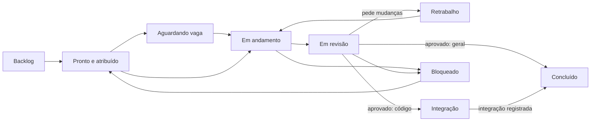

# Board da empresa e fluxo de trabalho dos agentes

Data: 29/10/2026. Estado: aprovado para implementação pelo usuário em 29/10/2026, após a conclusão do trabalho pendente do DSH.

## Intenção

Permitir que o usuário organize agentes como equipes funcionais da empresa, como Marketing e Desenvolvimento, e acompanhe trabalho em um board persistente. O Chief transforma pedidos em tarefas visíveis; agentes executam as tarefas atribuídas, outro agente revisa o resultado e solicitações de mudança voltam ao responsável original até a tarefa ser aprovada, integrada quando houver código, e encerrada com evidência.

O board deve tornar o trabalho rastreável entre conversas, execuções, revisão e workspaces. A experiência atual de conversa direta continua disponível e não passa a exigir Chief, equipe ou board.

## Comunicação permanece como hoje

O board é uma camada opcional de organização do trabalho, não substitui nem muda a forma de conversar com os agentes. O usuário continua podendo falar diretamente com o Assistente, com o Chief, com qualquer agente ou em grupos, usando o composer, menções, steering e fila de mensagens atuais. Mensagens comuns não viram tarefas automaticamente.

Uma tarefa aparece no board quando o usuário cria um cartão ou pede explicitamente ao Chief para organizar/delegar um trabalho rastreável. O Chief pode apresentar o cartão e continuar a conversa normal. Todo cartão ligado a uma execução abre a conversa/missão correspondente; o histórico da conversa continua sendo a transcrição completa, e o board mostra estado, revisão e evidências. A fila de mensagens existente não muda; a fila de execução é um estado separado das tarefas atribuídas.

## Decisão do usuário

Em 29/10/2026, o usuário escolheu “Board da empresa separado das missões”. A preferência inclui criar tarefas no board, atribuí-las a agentes, revisar o resultado e devolver problemas ao responsável até fechar. O paralelismo deve usar worktrees/branches isoladas para trabalho de código.

## Estado atual e restrições

- `Mission` é um objetivo persistente executado por um único responsável numa conversa. Pode continuar por vários turnos, pausar, aguardar uma decisão e retomar. A Central do Chief lista missões, mas não oferece um board de tarefas nem um revisor independente.
- `Delegation` persiste atribuição entre conversas e seu resultado, mas não representa um fluxo completo de revisão/retrabalho.
- Workspaces representam pastas/projetos. Worktrees Git já são workspaces filhos com branch própria; a fila permite até duas execuções raiz e serializa execuções que compartilham o mesmo caminho. Conversas em worktrees distintos podem executar em paralelo.
- A aplicação usa Electron, React, IPC tipado e SQLite local em `politron-v9.sqlite`. Alterações de entidades devem atravessar tipo compartilhado, store/migração, serviço, IPC/preload, snapshot/eventos e UI.
- Chief é opcional. Ferramentas atuais de coordenação respeitam aprovações e permissões do workspace. O board não deve desativar esse controle nem conceder novas permissões silenciosamente.
- `GitWorkspaceService` cria, consulta e remove worktrees, mas não implementa integração/merge de branches.

## Abordagens consideradas

1. **Usar missões como cartões do board.** Menor alteração e reaproveita o fluxo autônomo atual, mas mistura o objeto de trabalho da empresa com a execução de um agente; não modela bem equipe, revisor, rodadas de retrabalho nem tarefas de marketing sem execução autônoma.
2. **Criar tarefas persistentes separadas e vinculá-las às missões. Escolhida pelo usuário.** O board acompanha objetivo, equipe, responsável, revisão e fechamento. Missões continuam executando o trabalho e delegações continuam registrando colaboração. A mudança é maior, mas cada conceito preserva seu papel e as tarefas sobrevivem às conversas.
3. **Agentes monitorarem e reivindicarem tarefas livres automaticamente.** Dá autonomia máxima, porém exige coordenação de concorrência, lease/heartbeat, deduplicação e retomada antes de evitar trabalho duplicado. Fica fora do primeiro ciclo; atribuição do Chief ou do usuário cria um evento persistente que inicia o responsável designado.

## Proposta de produto

### Escopo e equipes

- Um board global local por instalação do Politron, acessível pela navegação principal sem abrir um workspace primeiro.
- Equipes nomeadas pelo usuário, como Marketing e Desenvolvimento, com participação de agentes existentes. Um agente pode participar de mais de uma equipe.
- Cada tarefa pertence a uma equipe e tem exatamente um responsável principal e um revisor distinto antes de começar. Outras pessoas/agentes citados recebem contexto, mas não se tornam co-responsáveis executando simultaneamente o mesmo cartão. Trabalho paralelo independente vira subtarefas, cada uma com seu responsável e, para código, seu próprio worktree.
- Workspace/projeto é opcional para tarefas gerais e obrigatório para tarefas de código que precisem alterar arquivos. A equipe não é uma conversa/grupo e sua criação não cria sessões automaticamente.
- O board é local ao usuário e não adiciona colaboração multiusuário, autenticação organizacional ou serviço em nuvem.

### Cartão e histórico

Cada tarefa persistida contém, no mínimo:

- ID, título, descrição, critério de aceite e tipo de trabalho (geral ou código).
- Equipe, responsável, revisor diferente do responsável e origem (usuário ou Chief).
- Estado e datas de criação, atualização, início e conclusão.
- Workspace de origem opcional; para código, workspace de execução/worktree e branch associada.
- Referências à missão atual e a execuções de revisão, sem copiar o histórico de conversa para o cartão.
- Rodada atual de revisão, decisão do revisor, motivo de retrabalho/bloqueio, resultado final e evidências (diff, testes/comandos e referências às conversas).
- Atividade durável de atribuição, início, progresso, fila, decisão de revisão, mudança de responsável, bloqueio, integração e conclusão.

O cartão é a fonte de estado do trabalho da equipe; a missão é a fonte de execução do agente; a conversa registra o diálogo completo. Atualizações do board nunca apagam mensagens, diffs ou evidências existentes.

### Fluxo

- O usuário ou o Chief cria o cartão e escolhe equipe, responsável e revisor. Se o Chief propõe a criação/atribuição, usa o fluxo de aprovação explícita atual; não há uma nova permissão persistente que libere o Chief silenciosamente. Uma recusa não deixa cartão parcialmente atribuído nem inicia execução. A ação do usuário no board não pede aprovação do Chief.
- Atribuir um responsável ou mencioná-lo como responsável no cartão registra um evento persistente e idempotente. Esse evento inicia uma missão ligada à tarefa. O agente recebe a descrição, critérios e contexto do board e atualiza o cartão com progresso/evidências. Não há polling contínuo por agentes nem duas execuções donas do mesmo cartão.
- O revisor é outro agente, obrigatório antes da execução, e só é acionado quando o responsável entrega o trabalho. Uma menção a outros agentes é informativa até eles receberem subtarefa ou atribuição explícita.
- Ao concluir o trabalho, o responsável entrega o cartão para revisão. O revisor avalia critérios e evidência em uma execução ligada ao mesmo cartão. O modo de revisão deve bloquear escrita pelo broker/ferramentas, não depender somente de instruções no prompt.
- Rejeição exige comentário objetivo e devolve o mesmo cartão ao responsável, mantendo worktree/branch e incrementando a rodada. O ciclo pode repetir. Se o usuário reatribuir porque o agente ficou indisponível, inicia-se uma missão/conversa nova para o novo responsável; as conversas e evidências anteriores permanecem ligadas ao mesmo cartão.
- Aprovação de tarefa sem código encerra o cartão. Aprovação de código leva a “Integração”: a branch revisada permanece preservada e o card só vira “Concluído” quando o usuário registrar a integração e sua evidência. O primeiro ciclo não faz merge automático.
- O Chief recebe um recibo final com resultado e evidências quando a tarefa fecha, ou pede ao usuário uma decisão quando o cartão é bloqueado.

### Paralelismo e fila

- Ao iniciar uma tarefa de implementação de código, criar uma worktree/branch exclusiva baseada no workspace Git selecionado. Reutilizar esse mesmo worktree nas rodadas de revisão e retrabalho; não colocar agentes independentes escrevendo no mesmo diretório. Uma análise de código sem escrita usa o workspace selecionado em modo somente leitura e não cria worktree.
- Tarefas em worktrees distintas continuam respeitando o limite atual de duas execuções raiz. O board mostra “Aguardando vaga” com posição/idade e distingue fila, agente ativo, espera por decisão e revisão. A criação do board não remove o limite de concorrência nem a serialização por caminho.
- Worktree criado para tarefa não é removido ao concluir ou cancelar automaticamente. Arquivar/remover exige fluxo seguro que inspeciona alterações e preserva diretórios sujos conforme o contrato atual.
- Integração de branches é serial e explícita no primeiro ciclo. Conflitos ou falhas de integração continuam visíveis no estado Integração e sobem ao Chief/usuário; não sobrescrever a branch-base silenciosamente.

### Tela

- Nova entrada “Board” na navegação principal, ao lado da Central do Chief e Rotinas; conversa direta e overview de workspace continuam independentes.
- Colunas por estado, contadores e filtros por equipe, responsável, projeto e tipo. Busca pelo título/descrição.
- Cartão compacto mostra título, equipe, responsável/revisor, workspace/branch, estado de execução (fila/atividade/espera) e atualização recente. O painel do cartão mostra descrição, critérios, atividade, decisões de revisão, evidências e links para as conversas da missão.
- Ações: criar/editar tarefa, atribuir responsável/revisor, abrir missão, pausar/retomar, aprovar, pedir mudanças, bloquear e registrar integração. Transições inválidas ficam indisponíveis e são também validadas no processo principal.
- Aplicar tokens, temas, componentes e acessibilidade existentes. A PWA pode consultar o board em modo somente leitura na primeira versão; criar/editar/atribuir, iniciar integrações e alterar estados ficam no desktop. A conversa normal e suas permissões remotas atuais não mudam.

## Objetivos

1. Acompanhar trabalho multiagente até a revisão e fechamento, mesmo quando cada etapa ocorre em conversas diferentes.
2. Executar tarefas de código em worktrees exclusivos e permitir revisão/retrabalho na mesma branch sem cruzar arquivos.
3. Mostrar de forma honesta quem está trabalhando, quem revisa e por que uma tarefa está aguardando.
4. Recuperar tarefas e eventos após reiniciar o app sem duplicar missões ou atribuições.
5. Conservar autorização, histórico, arquivos, diffs e fluxos atuais.

## Fora de escopo

- Substituir conversas livres, tornar o Chief obrigatório ou impor hierarquia a todos os agentes.
- Alterar composer, destinatários, menções, steering, conversas individuais/grupos ou a fila de mensagens; converter toda mensagem em cartão.
- Merge automático, rebase forçado, publicação/deploy ou exclusão de worktree pelo fechamento do cartão.
- Executar vários responsáveis na mesma tarefa/mesma pasta em paralelo.
- Monitores autônomos sem uma atribuição explícita, colaboração multiusuário, integração Slack/Jira ou calendário.
- Alterar permissões globais para o Chief, instalar dependências, trocar stack ou migrar banco legado.
- Chamar o board de sistema de gestão empresarial completo; é primeiro um fluxo local de coordenação de agentes.

## Defaults propostos após revisão técnica

- A criação e atribuição feitas pelo Chief usam a aprovação explícita já existente; não adicionar agora uma permissão global que altere sua autonomia. Tarefas criadas diretamente pelo usuário não precisam de aprovação adicional.
- Toda tarefa de equipe exige responsável e revisor distinto. Trabalho só começa quando ambos estão definidos.
- Reatribuição cria nova missão e conversa para preservar a autoria/contexto anterior; atividade, resultados, diffs e rodadas anteriores continuam no cartão.
- Apenas implementação com escrita precisa de worktree dedicado. Análise sem escrita pode ser executada em workspace existente, com bloqueio efetivo de escrita.
- A PWA acompanha o board em modo somente leitura; mutações pelo board e integração de código ficam no desktop. O canal de conversa atual continua disponível e sem alteração.

## Segurança, falhas e recuperação

- Validar todas as transições, membros da equipe, agentes ativos, workspace e vínculos de missão no processo principal.
- Cada atribuição usa chave de idempotência única; evento duplicado não abre duas missões. Recuperação após reinício reconcilia cartão, missão e run antes de retomar.
- Atribuição do Chief usa aprovação/permissão vigente; ferramentas de escrita e criação de worktree não ganham acesso fora do workspace escolhido.
- Se agente, runtime, worker, reviewer ou workspace desaparecer, preservar cartão e histórico, marcar impedimento com razão e permitir retomar/reatribuir pelo usuário.
- Registro de atividade não armazena segredos, tokens, conteúdo integral duplicado de mensagens ou saída ilimitada de ferramenta.
- Mudança de revisão registra quem decidiu, quando, em qual rodada, comentário e evidências avaliadas.

## Critérios de aceite

1. Criar equipes e tarefas, fechar e reabrir o app, e recuperar os mesmos cartões, atividades e atribuições.
2. Chief propõe criar/atribuir uma tarefa e segue a política de autorização existente; negar não inicia o agente nem grava execução órfã.
3. Atribuição aceita inicia uma única missão ligada ao cartão e registra o estado em eventos/snapshot.
4. Tarefas gerais seguem revisão/aprovação/conclusão; tarefas de código recebem worktree exclusivo, reviewer em modo somente leitura e passam por integração antes de Concluído.
5. Reviewer pode aprovar ou pedir alterações; retrabalho volta ao mesmo responsável/worktree, preserva evidências e registra a rodada sem criar cartão novo.
6. Duas tarefas em worktrees diferentes podem executar em paralelo dentro do limite atual; duas execuções no mesmo caminho continuam serializadas; a UI mostra espera e motivo.
7. Reinício ou repetição de evento não duplica missão, worktree ou rodada; cancelamento preserva arquivos.
8. Todas as transições inválidas e acesso não autorizado são recusados no processo principal, mesmo com chamada IPC forjada.
9. Navegação padrão, conversa direta, Central do Chief, rotinas, permissões e workspaces existentes continuam operando.
10. Typecheck, lint e build pertinentes passam; testes cobrem store/migração, serviço/transições/eventos, autorização/idempotência, UI e fila/worktree. Testes de integração validam ciclo worker → reviewer → retrabalho → aprovação → integração com dados descartáveis.

## Decisões deixadas ao implementador

- Normalização de equipes/tarefas/eventos em tabelas SQLite e índices adequados, seguindo as migrações progressivas atuais; evitar guardar listas grandes em snapshots.
- Contratos tipados de IPC, autorização das ferramentas do Chief e eventos de renderer sem transmitir histórico redundante.
- Nome/ID seguro de branch, limites de concorrência, estado observável do queue e política de recuperação de cada transição.
- Garantir escrita desabilitada no broker durante revisão e preservar a execução do responsável na mesma branch.
- Quais filtros e detalhes da tela são carregados inicialmente, mantendo contagem grande de cartões eficiente.

## Aprovação

O usuário autorizou iniciar a implementação depois de concluir o DSH: “Depois disso já pode partir pro outro plano”. A aprovação mantém a condição expressa pelo usuário: o board é opcional e não muda a forma de conversar com agentes, conversas, composer, menções, fila ou steering.

## Registro de implementação — 29/10/2026

- Implementado como tela superior independente, com equipes e tarefas persistidas no SQLite, eventos/evidências limitados, filtros por estado/responsável/projeto/tipo e vínculos para as conversas e missões de trabalho.
- O Chief pode consultar equipes/tarefas e propor uma tarefa atribuída. A autorização existente continua valendo; a tarefa guarda a conversa de origem e devolve atualização de conclusão, bloqueio ou cancelamento nessa conversa.
- Tarefas de código recebem worktree/branch própria. O revisor trabalha na mesma pasta com ferramentas do broker em modo somente leitura; retrabalho retorna ao responsável na mesma worktree. A conclusão de código depende de evidência de integração informada manualmente; nenhum merge é automático.
- Recuperação após reinício e repetição de atribuição são idempotentes. O board mostra posição/motivo da fila; a fila existente mantém paralelismo entre caminhos isolados e serialização pelo mesmo caminho.
- IPC de mutação é exclusivo do desktop. A PWA recebe snapshot somente para leitura. O composer, mensagens, menções, steering, grupos e fila de conversas não foram alterados.
- Fora do primeiro ciclo permanecem reivindicação automática de cartões livres, colaboração multiusuário, integração com serviços externos e merge automático. A revisão visual do board em Electron e o estado de uma PWA pareada não foram verificados nesta implementação.

Validação final: 10 arquivos focados/107 testes passaram; suíte Vitest completa: 150 arquivos/937 testes passaram, 15 arquivos/21 testes condicionais ignorados; `npm run typecheck`, build e `git diff --check` passaram. ESLint nas unidades do board, permissões, worktree e UI: 0 erros e 1 aviso de limite de linhas em `board.ts`. O ESLint dos arquivos de integração alterados ainda aponta 7 erros `no-explicit-any` existentes em `workspace.ts` e dois avisos de tamanho em `workspace.ts`/`chief-control.ts`; portanto, o critério de lint para esses arquivos não está limpo. O build emitiu avisos existentes do Vite sobre `use client`, sourcemaps, PostCSS e tamanho de chunks. Não houve revisão visual em Electron, sessão PWA pareada ou inferência real. Os detalhes por comando estão em `docs/superpowers/plans/2026-10-29-company-board.md`.
